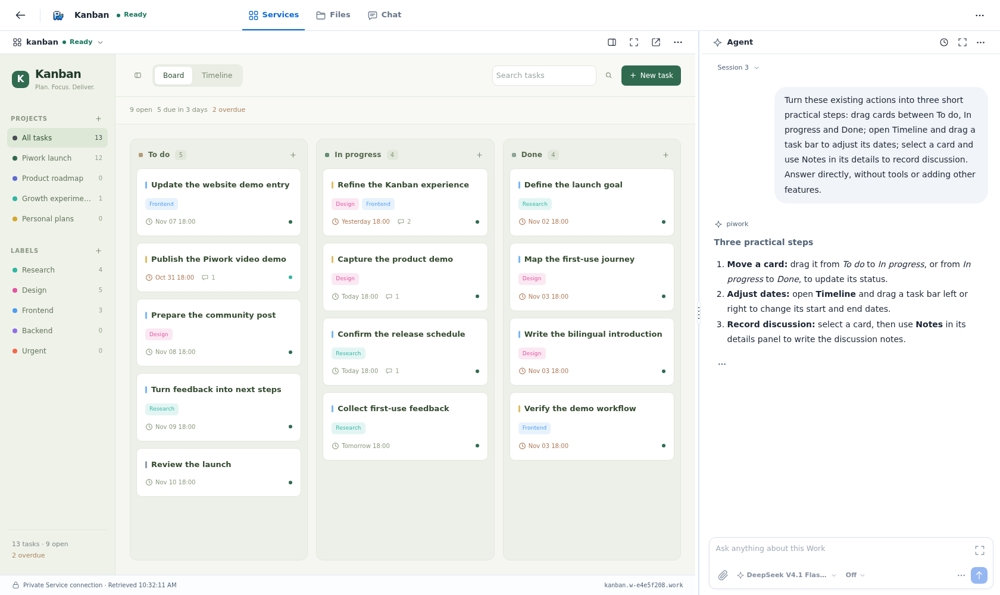

<p align="center">
  
</p>

# Piwork

**English** | [简体中文](README.zh-CN.md)

[](https://github.com/pphboy/piwork/releases)
[](LICENSE)
[](https://github.com/pphboy/piwork/stargazers)
[](deploy/docker/README.md)

**Build, run, operate, and evolve apps with AI. Share the entire workspace.**

AI can generate applications. But running them, integrating existing tools, making changes, and sharing the complete working environment still require extra effort.

**Piwork brings all of this into one portable AI workspace.**

Start from an idea or bring an existing web application. Let AI build, operate, and modify applications inside a Work, where your apps, environment, files, data, conversations, and settings stay together.

When you're ready, export the entire Work as a `.work` file. Move it to another Piwork installation and continue where you left off.



Use a running application and work with AI side by side.

## What can you do with Piwork?

- **Create with AI** — Describe what you want. Let AI build a working application, not just generate code.
- **Bring existing applications** — Integrate compatible open-source web applications into your Work instead of rebuilding everything from scratch.
- **Operate and evolve with AI** — Use applications, ask AI to work with them, add features, and modify existing functionality while keeping your work and context together.
- **Share and continue** — Package applications, their environment, files, data, and conversation history into a portable `.work` file for others to import and continue using.

## See it in action

**From an idea to a running app, and from one computer to another.**

[Watch the 70-second demo](https://www.youtube.com/watch?v=ll1MS091gPU) — Build a content studio, improve it with AI, and move the complete Work to another installation.

[Watch five real examples](https://www.youtube.com/watch?v=GiSqWeTWNUc) — Explore what different AI workspaces can create.

[Watch the demo on Bilibili](https://www.bilibili.com/video/BV1Uxx16VEYR).

[Explore the demos](https://pphboy.github.io/piwork/demos/) — Browse real applications and download a Work to try.

## How does it work?

A **Work** is a self-contained AI workspace connecting three things:

- **Harness** — The AI agent runtime, built on Pi Agent SDK and extensible through Skills and Pi Packages.
- **Service** — An application that runs inside the workspace.
- **Workspace** — Conversations, files, data, environment, and configuration that make your work reusable.

Together, they let AI work with real applications, not just produce text or code.

## Quick Start

Download and run the Piwork MicroVM GUI binary for your platform:

**Linux amd64**

```sh
curl -fL https://github.com/pphboy/piwork-microvm/releases/download/v0.2.6/piwork-microvm-gui-v0.2.6-linux-amd64 -o piwork-microvm-gui &&
  chmod +x piwork-microvm-gui &&
  ./piwork-microvm-gui
```

**Windows 11 amd64 (PowerShell)**

```powershell
$ErrorActionPreference = 'Stop'
Invoke-WebRequest -Uri 'https://github.com/pphboy/piwork-microvm/releases/download/v0.2.6/piwork-microvm-gui-v0.2.6-windows-amd64.exe' -OutFile '.\piwork-microvm-gui.exe'
Start-Process -FilePath '.\piwork-microvm-gui.exe'
```

Click **Start Piwork** in the launcher, then follow the [Quick Start guide](https://pphboy.github.io/piwork/guide/quick-start.html) to configure your AI model. See [Downloads](https://pphboy.github.io/piwork/guide/downloads.html) for virtualization requirements, desktop runtime dependencies, and checksums.

Piwork is currently a preview. MicroVM provides a local launcher for Windows and Linux; standalone Core and the native CLI support Linux amd64, and Windows and Linux browsers can access Core remotely.

## Documentation

- [Website and guides](https://pphboy.github.io/piwork/)
- [Server deployment guide](deploy/docker/README.md)
- [Core releases](https://github.com/pphboy/piwork/releases)
- [MicroVM GUI releases](https://github.com/pphboy/piwork-microvm/releases)

## Roadmap

- Make the Work lifecycle and portability more reliable.
- Refine onboarding, model configuration, and Desktop UX.
- Expand reusable Works and application examples.

## Contributing

See [AGENTS.md](AGENTS.md) for development conventions, source builds, and verification.

- [Report an issue](https://github.com/pphboy/piwork/issues)
- [Join the discussion](https://github.com/pphboy/piwork/discussions)

## Acknowledgments and Community

Thanks to [LinuxDo](https://linux.do).

## License

[Apache License 2.0](LICENSE)

[FastAPI + htmx Service environment](deploy/images/fastapi-htmx-base/README.md)
