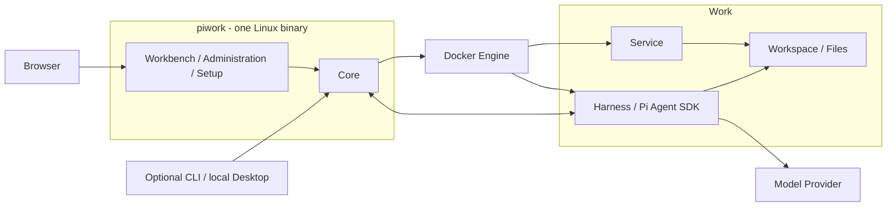

<p align="center">
  
</p>

# Piwork

**English** | [简体中文](README.zh-CN.md)

Piwork is an AI work environment that groups conversations, files, and container services into a Work you can manage, export, and move between installations.

## Architecture



Core manages resources and control operations. The Harness runs models and tools, Services provide applications, and work files live in the Work's shared volume. See [Core operations](openspec/specs/core-service-startup/spec.md) for runtime and data boundaries, and [AGENTS.md](AGENTS.md) for implementation and directory conventions.

## Problem

An AI task often involves conversation history, project files, and running services. Piwork organizes these into a Work so you can converse, run applications, manage files, and preserve the environment across stops, restarts, and migrations.

## Piwork's Core Model: Work / Service / Harness

| Model | Meaning |
| --- | --- |
| **Work** | A unit of work with its own configuration, conversation history, files, and service definitions. It can be started, stopped, exported, and imported. |
| **Service** | An application service inside a Work. Core manages its lifecycle; it communicates over the Work's private network and can share the workspace when authorized. |
| **Harness** | The agent execution layer inside a Work. It uses the Pi Agent SDK to run conversations, models, and tools, and load Skills and Pi Packages. |

Each Work has its own Harness. The Harness executes tasks, Services provide application capabilities, and both operate within the Work. Core manages these resources. The unified application provides the browser workbench; CLI / local Desktop remains optional.

The current source defaults new application Services to Python + NiceGUI + SQLite, with standard dependencies preinstalled and support for additional Python packages. The NiceGUI base now has an anonymously verified fixed release; platform Docker references retain their recorded release identities. See the [Web base guide](deploy/images/web-base/README.md) for source, maintenance, dependency installation, sqlite3 and automatic application updates.

Core 0.0.7 ships piwork-brain 1.2.2 with the published NiceGUI default. The [release record](deploy/docker/releases/0.0.7-19fc33907232-3ab753f8a90a.json) lists the published image identities.

Release 0.0.7 embeds piwork-brain 1.2.2 with an independent `application-awareness` Skill for product, UI/UX, state synchronization and engineering judgment. Brain routes application work to it directly; the deployment Skill remains separate. It adds no design or approval stage. NiceGUI-specific guidance is read only when relevant. Page verification uses the actual Desktop Service entry with an available, authorized browser; backend readiness alone does not prove UI usability, and unavailable browser access is reported explicitly. See [Brain loading and adoption](openspec/specs/piwork-brain/spec.md#requirement-安装并实际加载-work-自有的大脑包).

Release 0.0.7 reuses successful image checks and package-environment probes, and prepares the default Work environment before Core becomes ready. See [build and verification entry points](AGENTS.md#构建与验证) for building and checking the source.

The default templates adopt successfully deployed updates automatically and preserve supported drafts and paths. Application Services have no Piwork memory cap; CPU/count limits and Agent/helper memory policies still apply. Existing Works adopt new packages and Agent images through explicit Update/Apply. See the [website guide](https://pphboy.github.io/piwork/guide/web-development.html) and [Brain workflow](openspec/specs/piwork-brain/spec.md#requirement-安装并实际加载-work-自有的大脑包).

Release 0.0.7 improves Desktop export and download completion, draft and file-operation continuity, menus and split-pane keyboard interaction, and safe assistant Markdown rendering. Downloads are available in [0.0.7 Preview](https://github.com/pphboy/piwork/releases/tag/v0.0.7).

## Demo GIF / Video

[](https://www.youtube.com/watch?v=ll1MS091gPU)

[Watch the 70-second product demo on YouTube](https://www.youtube.com/watch?v=ll1MS091gPU): AI creates a content studio, adds a publishing calendar while preserving existing ideas, and the entire Work is exported, imported into another Piwork environment, and started again.


Desktop chat interface preview, captured from a UI verification fixture.

Release 0.0.7 accepts pasted, dropped or selected images in Chat, including image-only messages. **About Piwork** shows Desktop/Core versions and embedded release notes, with a link to all releases. Use matching Desktop, Core and Agent components; known limitations and image limits are listed in the [Desktop guide](openspec/specs/desktop-webui/spec.md).

## Quick Start

### Start Piwork with one command

<!-- docker-quickstart:start -->

**Local candidate: images have not been pushed.** These commands describe the pending candidate; older images do not contain the unified entry.

Use Linux x86-64 and rootful Docker Engine 28+. One container serves the workbench, administration and first-time setup, with no environment variables or client CLI required:

```sh
docker run --detach --init \
    --name piwork-core-quickstart \
    --network host \
    --restart unless-stopped \
    --stop-timeout 60 \
    --mount type=bind,src=/var/run/docker.sock,dst=/var/run/docker.sock \
    --volume /var/lib/piwork/quickstart/core:/var/lib/piwork/quickstart/core \
    docker.io/pphboy/piwork-core:0.0.7-62f2868cb8e2-d69916b52829-dirty
```

Open the reported access address. For a detached container, retrieve the first-time setup link on the server. It authorizes creation of the first administrator and expires after ten minutes; keep it private:

```sh
docker logs piwork-core-quickstart
```

If it expires, retrieve a new link as the installation operator:

```sh
docker exec piwork-core-quickstart piwork-serve --data-dir /var/lib/piwork/quickstart/core setup link
```

Create the administrator with a password and matching confirmation, then sign in to **Quick setup** in Admin (`/admin/setup`). Follow the two-step guide: enter the model ID, API type, Base URL and API Key, or choose a saved model, then select **Save and continue**. This saves the model and binds CoreRuntime in sequence. The preparation page updates automatically; when all required components are Ready, select **Open workbench** to enter Piwork. The Agent image is embedded with the server release and supplied automatically; it has no input, selector or advanced override. Model Test is explicit and optional; saving does not call the model. Open the workbench to create a Work, chat, manage files or open Services. Return through Admin **Overview → Quick setup** to change configuration. The topbar **Workbench** link remains available while preparation finishes; the completion action waits for all components. Saved accounts, models and Works survive restart.

The server listens on `0.0.0.0:7171` by default. Local or remote computers open `http://SERVER_IP:7171` using its actual non-loopback IP. A local network is sufficient; no public IP is required. Allow TCP 7171 for the main site and TCP 17891–17954 for Service entries (override with `--service-ports`); 7172 is internal Agent RPC, not a browser port. Piwork proxies these ports; user containers are not published directly. Opening only the main port leaves the workbench usable but Services unreachable. No domain, DNS or local proxy is required. HTTP is unencrypted; configure HTTPS explicitly for untrusted networks and expose/proxy both the main site and every Service entry port.

Services support server-side login using response Cookies, Basic/Bearer, HTTP, SSE and WebSocket. Response Cookies stay on the server, partitioned by browser session and Service; Secure Cookies are sent only through HTTPS entries. Apps that read/write document.cookie or Cookie Store (including script-read CSRF Cookies) are not guaranteed to work transparently. Script-written browser Cookies are not isolated across Services on the same IP and are never forwarded upstream. Hard-coded .work URLs, cross-site SSO and upstream HTTPS are outside transparent support. Application CSP/X-Frame-Options remain intact; open an application tab when embedding is denied.

Optional [Compose](deploy/docker/docker-compose.yml) (2.24+) and the [single-host example](examples/single-host/README.md) open the same web application. CLI is an optional advanced tool. See the [operations guide](deploy/docker/README.md#terminal-operations) for recovery.

<!-- docker-quickstart:end -->

For Windows Docker clients, remote Linux Core addresses, or the advanced Core-only Demo, see the [Docker guide](deploy/docker/README.md#terminal-operations).

<details>
<summary>Use the native Linux application (source candidate)</summary>

<!-- native-quickstart:start -->

The unified entry is a source candidate; the published 0.0.7 bundle retains its previous behavior. After building below, start the Linux program (the executable also works outside the checkout):

```sh
./dist/go/piwork --no-open
```

Data defaults to `piwork/server` in the user configuration directory and the listener to `0.0.0.0:7171`; use the actual IP link printed in the terminal. See `--help` for `--data-dir`, `--listen`, `--public-origin`, `--service-ports` and TLS options. Keep the first-time setup link private. The Agent image is embedded with the server release and used automatically, with no image input or override. Create the administrator and configure the model in the browser; `piwork setup link` rotates an expired proof. Exiting this program stops managed Works under the Core shutdown contract; closing a browser does not.

`piwork-cli` retains its independent Windows/Linux terminal and local Desktop modes. `piwork-console` remains the older standalone administrator entry and is not required for default startup. The historical [0.0.7 Linux bundle](https://github.com/pphboy/piwork/releases/download/v0.0.7/piwork-linux-amd64-0.0.7.tar.gz) and [experimental Windows CLI 0.0.5](https://github.com/pphboy/piwork/releases/download/v0.0.5/piwork-cli-windows-amd64-0.0.5.exe) do not contain this unified server entry.

<!-- native-quickstart:end -->

</details>

To deploy Core from source, see [Core startup and initialization](openspec/specs/core-service-startup/spec.md); administrator access is described in the [Console guide](openspec/specs/serve-control-plane/spec.md).

Model connections can be managed in Console **AI models**: independent Responses / Messages models, advisory message Test and lifecycle actions, without Provider or capability JSON setup. Work Chat keeps its existing model and Thinking selection. This flow requires matching current Core, Console, Agent and CLI builds; existing Works explicitly Apply a compatible Agent. See [AI models](openspec/specs/ai-model-management/spec.md).

## .work Import / Export

A `.work` file is a complete offline copy of a Work, including files in its managed volumes, private conversation history, configuration, service definitions, Skills, Pi Packages, and fixed container images.

The following commands use the native Linux CLI. Log in to the appropriate Core first. Replace `WORK_ID` with the source Work ID and `IMPORTED_WORK_ID` with the new ID returned by import. The export destination must not already exist.

```sh
./piwork-cli work stop WORK_ID --wait
./piwork-cli work export WORK_ID --output ./saved.work
./piwork-cli work package inspect ./saved.work
./piwork-cli work import ./saved.work --name 'Restored Work' --wait
./piwork-cli work start IMPORTED_WORK_ID --wait
```

Stop the Work before exporting. Import creates an independent Work and leaves it stopped; start it explicitly afterward. To migrate to another Core, log in to the target Core before importing and starting it. Offline inspect verifies package integrity, not whether the target installation can use it.

Configure matching model credentials on the target Core separately. Platform-managed model keys and installation credentials are excluded from the package, but secrets saved in your files or history travel with it. See [Work snapshots](openspec/specs/work-snapshots/spec.md) and the [package format](openspec/specs/portable-work/spec.md) for the complete workflow and data boundaries.

## Current Status / Limitations

- **Unified entry candidate**: Current source supports a Linux server with one-command browser workbench, administration and onboarding. Windows/Linux browsers connect remotely. The unified image is not published; historical releases do not identify this candidate.
- **0.0.7 Preview**: Intended for evaluation and feedback. The native Windows CLI is experimental and has not completed all formal acceptance checks.
- **Core**: A single Linux installation using the local Docker Engine Unix socket.
- **Clients**: The native CLI targets Windows and Linux, with command-line and Desktop interfaces. Native Windows acceptance remains incomplete; [CLI requirements](openspec/specs/control-cli/spec.md) describe supported behavior.
- **Docker delivery**: The verified scope is `linux/amd64`, Linux Core, and Linux CLI containers on Linux or Windows Docker Desktop. Docker Engine 28+ is required; Compose 2.24+ is needed when choosing the Core-only deployment, the single-host example or advanced Compose setups. See [delivery requirements](openspec/specs/docker-delivery/spec.md).
- **Runtime requirements**: Running a Work requires an available Docker Engine, model configuration, and credentials. A normal Core shutdown stops managed Work containers and preserves persistent data. Closing a browser or exiting CLI does not stop Works.
- **Verification**: See [build and test entry points](AGENTS.md#构建与验证) for prerequisites and checks. Platform and real-interaction coverage is reported with the corresponding execution results; skipped checks do not count as passing.

## Roadmap

Piwork is still early. The current focus is to make the Work lifecycle reliable, portable, and easy to understand.

### Near term

- Improve the first-run experience and installation flow
- Strengthen `.work` import / export reliability
- Improve Windows client compatibility
- Improve Desktop UX and model configuration
- Publish more example Works and end-to-end demos

### Next

- Make Works easier to share and reuse
- Improve Service lifecycle management
- Expand Harness capabilities and tool integration
- Improve cross-machine and multi-environment portability
- Introduce better Work packaging and distribution

### Longer term

- Evolve Piwork into a portable AI-native workspace runtime
- Let Harnesses adapt and evolve with the Work
- Enable AI to operate and modify Services directly
- Explore layered Work packaging and richer distribution models

The roadmap will evolve based on real usage and feedback.

## Contributing

Read [AGENTS.md](AGENTS.md) for development conventions and the [testing guide](AGENTS.md#构建与验证) for test entry points. The basic build requires Go 1.25.5, Node 24 (see `.nvmrc`)/npm, Git, Make, and Bash. Run these commands from the repository root:

```sh
npm ci
make build
make test
```

`make build` writes native programs to `dist/go/` and builds the Agent and browser assets. Building and running unit tests does not require real model keys, local runtime data, or `.env.test`. To build only the client, run `npm run build:cli`; artifacts are written to `dist/cli/<target>/`.

## License

[Apache License 2.0](LICENSE)

## Discussion / Issue
