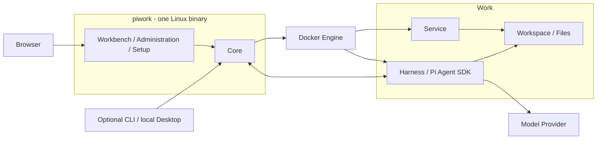

<p align="center">
  
</p>

# Piwork

[English](README.md) | **简体中文**

Piwork 是一个以 Work 为单位，整合 AI 对话、工作文件和容器服务，并支持导出与迁移的工作环境。

## Architecture 简图



Core 负责资源管理与控制，Harness 执行模型和工具，Service 提供应用，工作文件保存在 Work 的共享卷中。运行和数据边界见 [Core 运维](openspec/specs/core-service-startup/spec.md)；实现与目录约定见 [AGENTS.md](AGENTS.md)。

## Problem

一次 AI 工作通常同时涉及对话历史、项目文件和需要持续运行的服务。Piwork 将这些内容组织为一个 Work，让用户在同一环境中对话、运行应用和管理文件，并通过启停、恢复和迁移继续使用这个环境。

## Piwork 的核心模型：Work / Service / Harness

| 模型 | 含义 |
| --- | --- |
| **Work** | 用户的工作单元，保存独立的配置、对话历史、工作文件和服务定义，可启动、停止、导出和导入。 |
| **Service** | Work 内的应用服务，由 Core 管理生命周期，通过 Work 私网通信，并按授权共享工作目录。 |
| **Harness** | Work 中的 Agent 执行层，基于 Pi Agent SDK 运行对话、模型和工具，加载 Skill 与 Pi Package。 |

每个 Work 拥有自己的 Harness。Harness 执行任务，Service 提供应用能力，两者在 Work 的环境中协作；Core 管理这些资源，统一应用提供网页工作台；CLI / 本机 Desktop 为可选入口。

当前源码对新应用 Service 默认采用 Python + NiceGUI + SQLite，预装标准依赖并支持追加 Python 包。NiceGUI base 已取得匿名验证的固定发行引用；平台 Docker 引用保留各自记录的发行身份。源码、维护、依赖安装、sqlite3 及应用自动更新见 [Web base 手册](deploy/images/web-base/README.zh-CN.md)。

Core 0.0.7 内置 piwork-brain 1.2.2，并采用已发布的 NiceGUI 默认环境。[发行记录](deploy/docker/releases/0.0.7-19fc33907232-3ab753f8a90a.json)列出已发布镜像的固定身份。

0.0.7 内置 piwork-brain 1.2.2，提供独立 `application-awareness` Skill，承载产品、UI/UX、状态同步与工程取舍认知。Brain 直接路由应用开发任务，部署 Skill 保持平级职责，不增加设计或审批阶段。NiceGUI 专项指导按需读取；页面验证使用实际 Desktop Service 入口及可用、获准的浏览器，后端就绪不替代界面可用，浏览器访问能力不足时明确说明。加载与采用见 [Brain 说明](openspec/specs/piwork-brain/spec.md#requirement-安装并实际加载-work-自有的大脑包)。

0.0.7 复用成功的镜像检查与包环境探测，并在 Core 就绪前准备默认 Work 环境。源码构建与检查见[构建与验证入口](AGENTS.md#构建与验证)。

默认模板自动采用成功部署的更新，并保留支持恢复的草稿与路径。应用 Service 不设置 Piwork 内存上限；CPU/数量限制和 Agent/helper 内存政策仍有效。既有 Work 通过显式 Update/Apply 采用新包与 Agent 镜像。详见[官网指南](https://pphboy.github.io/piwork/zh/guide/web-development.html)和 [Brain 工作流程](openspec/specs/piwork-brain/spec.md#requirement-安装并实际加载-work-自有的大脑包)。

0.0.7 改进 Desktop 的导出与下载闭环、草稿和文件操作连续性、菜单与分栏键盘交互，并安全显示助手 Markdown。下载见 [0.0.7 Preview](https://github.com/pphboy/piwork/releases/tag/v0.0.7)。

## Demo GIF / Video

[](https://www.youtube.com/watch?v=ll1MS091gPU)

[在 YouTube 观看 70 秒产品演示](https://www.youtube.com/watch?v=ll1MS091gPU)：AI 创建内容工作室，在保留已有灵感的基础上加入发布日历，再将整个 Work 导出、导入另一套 Piwork 环境并重新启动。


Desktop 聊天界面的预览截图，来自界面验证 fixture。

0.0.7 的 Chat 支持粘贴、拖拽或选择图片，也可只发送图片。**About Piwork** 分别显示 Desktop/Core 版本及内置更新日志，并提供完整 Releases 链接。需要匹配的 Desktop、Core 和 Agent；已知限制和图片限额见 [Desktop 使用说明](openspec/specs/desktop-webui/spec.md)。

## Quick Start

### 一键启动 Piwork

<!-- docker-quickstart:start -->

**本地候选：镜像尚未推送。** 以下命令对应待验证候选，不能用旧版镜像代替统一入口。

Linux x86-64、rootful Docker Engine 28+。运行一个容器即可提供工作台、管理和首次设置，无需环境变量或客户端 CLI：

```sh
docker run --detach --init \
    --name piwork-core-quickstart \
    --network host \
    --restart unless-stopped \
    --stop-timeout 60 \
    --mount type=bind,src=/var/run/docker.sock,dst=/var/run/docker.sock \
    --volume /var/lib/piwork/quickstart/core:/var/lib/piwork/quickstart/core \
    docker.io/pphboy/piwork-core:0.0.7-7aa5f944fc2a-ee65124bec72-dirty
```

打开终端输出中的访问地址。后台启动时，在服务器查看首次设置链接；该链接授权创建首管理员，十分钟后过期，请勿分享：

```sh
docker logs piwork-core-quickstart
```

链接过期时取得新链接（仅安装维护者可执行）：

```sh
docker exec piwork-core-quickstart piwork-serve --data-dir /var/lib/piwork/quickstart/core setup link
```

浏览器创建管理员并登录，按引导保存模型 ID、API 类型、Base URL 和 API Key，再保存 CoreRuntime，等待依赖准备完成。Agent 镜像随服务端版本内置并自动使用，无需也不能手填、选择或高级覆盖。模型 Test 是显式可选操作；保存不自动调用模型。打开工作台创建 Work，然后聊天、管理文件或打开 Service。已保存的账号、模型和 Work 在重启后保留。

服务端默认监听 `0.0.0.0:7171`；本机或远程电脑通过实际非回环 IP 打开 `http://服务器IP:7171`。局域网即可使用，无需公网地址。主站放行 TCP 7171，Service 入口另需 TCP 17891–17954（可用 `--service-ports` 修改）；7172 是内部 Agent RPC，不向浏览器开放。端口由 Piwork 代理，不是用户容器直出。只开放主站时工作台仍可使用，Service 入口会不可达。无需域名、DNS 或本机代理。HTTP 不加密；不可信网络请显式配置 HTTPS，并同时放行/代理主站与全部 Service 端口。

Service 支持响应 Cookie 的服务端登录、Basic/Bearer、HTTP、SSE 和 WebSocket。响应 Cookie 按浏览器会话及 Service 保存在服务器，Secure Cookie 仅通过 HTTPS 入口发送。依赖 document.cookie/Cookie Store 读写（如脚本读取 CSRF Cookie）的应用不保证透明兼容；脚本写入浏览器 Cookie 也不保证同 IP 跨 Service 隔离，且不会转发上游。不支持硬编码 .work URL、跨站 SSO 或上游 HTTPS 的透明适配。应用 CSP/X-Frame-Options 保留；禁止嵌入时使用新标签页。

可选 [Compose](deploy/docker/docker-compose.yml)（2.24+）和 [单机示例](examples/single-host/README.zh-CN.md) 同样直接进入网页；CLI 是高级可选工具。运行与恢复见 [安装手册](deploy/docker/README.zh-CN.md#terminal-operations)。

<!-- docker-quickstart:end -->

Windows Docker 客户端、远端 Linux Core 地址和高级 Core-only Demo 见 [Docker 手册](deploy/docker/README.zh-CN.md#terminal-operations)。

<details>
<summary>使用原生 Linux 应用（源码候选）</summary>

<!-- native-quickstart:start -->

本次统一入口是源码候选，旧 0.0.7 发布包仍保留原行为。完成下方构建后，从任意目录启动 Linux 程序：

```sh
./dist/go/piwork --no-open
```

默认数据目录为用户配置目录下 `piwork/server`，监听 `0.0.0.0:7171`；使用终端给出的实际 IP 链接。`--data-dir`、`--listen`、`--public-origin`、`--service-ports` 和 TLS 参数见 `--help`。首次设置链接只给安装维护者。Agent 镜像随服务端版本内置并自动使用，不提供手填或覆盖；网页创建管理员后配置模型。`piwork setup link` 可轮换过期证明。退出主程序会按 Core 关闭契约停止受管 Work；关闭网页不会。

`piwork-cli` 保留独立 Windows/Linux 命令行与本机 Desktop；`piwork-console` 仅为旧独立管理入口，不属于默认启动依赖。历史 [0.0.7 Linux 发布包](https://github.com/pphboy/piwork/releases/download/v0.0.7/piwork-linux-amd64-0.0.7.tar.gz) 与 [实验性 Windows CLI 0.0.5](https://github.com/pphboy/piwork/releases/download/v0.0.5/piwork-cli-windows-amd64-0.0.5.exe) 不包含本次统一服务端入口。

<!-- native-quickstart:end -->

</details>

从源码部署 Core 见 [Core 启动与初始化](openspec/specs/core-service-startup/spec.md)；管理员入口见 [Console 手册](openspec/specs/serve-control-plane/spec.md)。

可在 Console **AI models** 直接添加 Responses / Messages 模型，无需 Provider 或能力 JSON 配置，执行独立 HTTP Test 并管理生命周期；Work Chat 保留模型和 Thinking 选择。此流程需要配套的当前 Core、Console、Agent 与 CLI；旧 Work 采用兼容 Agent 仍须显式 Apply。见 [AI 模型](openspec/specs/ai-model-management/spec.md)。

## .work Import / Export

`.work` 是 Work 的完整离线副本，包含受管卷中的文件、私有对话历史、配置、服务定义、Skill、Pi Package 和固定容器镜像。

下面使用 Linux 原生 CLI；先登录对应 Core，将 `WORK_ID` 替换为源 Work ID，将 `IMPORTED_WORK_ID` 替换为导入结果中的新 Work ID。导出路径必须尚不存在。

```sh
./piwork-cli work stop WORK_ID --wait
./piwork-cli work export WORK_ID --output ./saved.work
./piwork-cli work package inspect ./saved.work
./piwork-cli work import ./saved.work --name 'Restored Work' --wait
./piwork-cli work start IMPORTED_WORK_ID --wait
```

导出前必须停止 Work；导入会创建独立的新 Work，并保持停止状态，随后显式启动。迁移到另一台 Core 时，先在目标 Core 登录，再执行 import 和 start。离线 inspect 检查包的完整性，不代表目标安装已验证。

目标 Core 需要另行配置匹配的模型凭据；平台管理的模型 key 和安装凭证不会随包迁移，但工作文件和历史中自行保存的秘密仍会进入包。完整流程和数据边界见 [Work 快照](openspec/specs/work-snapshots/spec.md) 与 [包格式](openspec/specs/portable-work/spec.md)。

## Current Status / Limitations

- **统一入口候选**：当前源码仅支持 Linux 服务端，一条命令启动网页工作台、管理和引导；Windows/Linux 浏览器可远程连接。统一镜像尚未推送，历史发行记录不代表本次候选。
- **0.0.7 Preview**：用于试用与反馈。Windows 原生 CLI 为实验性附件，尚未完成全部正式验收。
- **Core**：当前为单机 Linux 部署，使用本机 Docker Engine Unix socket。
- **客户端**：原生 CLI 面向 Windows 和 Linux，提供命令行与 Desktop；Windows 原生正式验收尚未全部完成，[CLI 要求](openspec/specs/control-cli/spec.md)说明受支持的行为。
- **Docker 交付**：当前验收范围为 `linux/amd64`、Linux Core，以及 Linux / Windows Docker Desktop 的 Linux CLI 容器；要求 Docker Engine 28+；选择 Core Compose、单机部署示例或高级 Compose 部署时另需 Compose 2.24+。详情见 [交付要求](openspec/specs/docker-delivery/spec.md)。
- **运行条件**：实际 Work 执行需要可用的 Docker Engine、模型配置与凭据。Core 正常退出会停止受管 Work 的运行容器并保留持久数据；关闭网页或退出 CLI 不停止 Work。
- **验证状态**：前置条件和检查入口见[构建与测试](AGENTS.md#构建与验证)。平台与真实交互的覆盖范围随对应执行结果记录；跳过项不算通过。

## Roadmap

Piwork 仍处于早期阶段。当前重点是让 Work 的生命周期可靠、可迁移且易于理解。

### 近期

- 改善首次使用体验和安装流程
- 提升 `.work` 导入 / 导出的可靠性
- 改善 Windows 客户端兼容性
- 改善 Desktop 用户体验和模型配置
- 发布更多 Work 示例和端到端演示

### 下一阶段

- 让 Work 更易于分享和复用
- 改善 Service 生命周期管理
- 扩展 Harness 能力和工具集成
- 提升跨机器和多环境的可迁移性
- 引入更完善的 Work 打包和分发机制

### 长期

- 将 Piwork 演进为可迁移的 AI 原生工作空间运行时
- 让 Harness 随 Work 适应和演进
- 让 AI 能够直接操作和修改 Service
- 探索分层 Work 打包和更丰富的分发模式

路线图将根据实际使用情况和反馈持续调整。

## Contributing

开发约定见 [AGENTS.md](AGENTS.md)，测试入口见 [测试说明](AGENTS.md#构建与验证)。基础构建需要 Go 1.25.5、Node 24（`.nvmrc`）/npm、Git、Make 和 Bash，在仓库根目录执行：

```sh
npm ci
make build
make test
```

`make build` 输出原生程序到 `dist/go/`，同时构建 Agent 和浏览器资源。构建与单元测试不需要真实模型 key、本机运行数据或 `.env.test`。只构建客户端可执行 `npm run build:cli`，产物位于 `dist/cli/<目标>/`。

## License

[Apache License 2.0](LICENSE)

## Discussion / Issue
