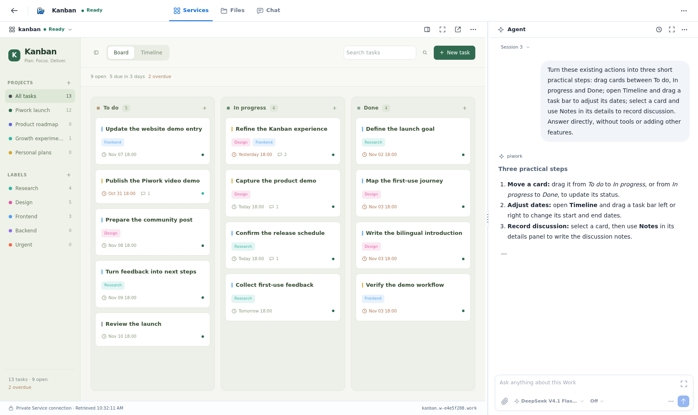

  

# Piwork

[English](README.md) | **简体中文**

**用 AI 构建、运行、操作和持续改进应用，分享整个工作空间。**

AI 可以生成应用。但要运行应用、集成现有工具、持续修改，以及分享完整的工作环境，仍然需要额外的工作。

**Piwork 将这些能力整合到一个可迁移的 AI 工作空间。**

从一个想法开始，或带入已有的 Web 应用。让 AI 在 Work 中构建、操作和修改应用，让应用、环境、文件、数据、对话和设置始终保留在一起。

准备好后，将整个 Work 导出为 `.work` 文件。将它迁移到另一套 Piwork 安装，即可接着之前的工作继续。

一边使用运行中的应用，一边与 AI 协作。

## Piwork 能做什么？

- **用 AI 创建应用** — 描述你的需求，让 AI 构建可以使用的应用，而不只是生成代码。
- **带入现有应用** — 将兼容的开源 Web 应用集成到 Work，无需一切从零开始。
- **用 AI 操作和持续改进** — 使用应用，让 AI 协助操作、添加功能或修改现有功能，同时保留工作成果和上下文。
- **分享并继续使用** — 将应用、环境、文件、数据和对话历史打包成可迁移的 `.work` 文件，供他人导入并继续使用。

## 看看实际效果

**从想法到运行中的应用，再从一台电脑迁移到另一台。**

[观看 70 秒演示](https://www.youtube.com/watch?v=ll1MS091gPU) — 构建内容工作室，用 AI 持续改进，再将完整的 Work 迁移到另一套安装。

[观看五个真实案例](https://www.youtube.com/watch?v=GiSqWeTWNUc) — 看看不同的 AI 工作空间能创造什么。

[在 Bilibili 观看演示](https://www.bilibili.com/video/BV1Uxx16VEYR)。

[浏览应用演示](https://pphboy.github.io/piwork/demos/) — 查看真实应用，下载 Work 亲自体验。

## 它如何工作？

**Work** 是一个自包含的 AI 工作空间，将三部分连接起来：

- **Harness** — 基于 Pi Agent SDK 的 AI Agent 运行时，可通过 Skills 和 Pi Packages 扩展能力。
- **Service** — 在工作空间内运行的应用。
- **Workspace** — 对话、文件、数据、环境和配置，让你的工作可以继续使用。

它们让 AI 能够操作真实应用，而不只是输出文字或代码。

## 快速开始

[下载 Piwork MicroVM GUI](https://pphboy.github.io/piwork/zh/guide/downloads.html)，在 Windows 或 Linux 本地运行 Piwork。选择对应平台的 GUI 版本，再按照[快速开始指南](https://pphboy.github.io/piwork/zh/guide/quick-start.html)启动 Piwork 并配置 AI 模型。

Piwork 目前处于预览阶段。MicroVM 提供 Windows 和 Linux 本地启动器；独立 Core 与原生 CLI 支持 Linux amd64，Windows 与 Linux 浏览器均可远程访问 Core。

## 文档

- [官网与指南](https://pphboy.github.io/piwork/zh/)
- [服务端部署手册](deploy/docker/README.zh-CN.md)
- [Core 发布版本](https://github.com/pphboy/piwork/releases)
- [MicroVM GUI 发布版本](https://github.com/pphboy/piwork-microvm/releases)

## 路线图

- 提升 Work 生命周期与迁移的可靠性。
- 改进首次引导、模型配置与 Desktop 体验。
- 丰富可复用 Work 和应用示例。

## 参与贡献

开发约定、源码构建与验证入口见 [AGENTS.md](AGENTS.md)。

- [反馈问题](https://github.com/pphboy/piwork/issues)
- [参与讨论](https://github.com/pphboy/piwork/discussions)

## 致谢与社区

感谢 [LinuxDo](https://linux.do)。

## 许可证

[Apache License 2.0](LICENSE)
