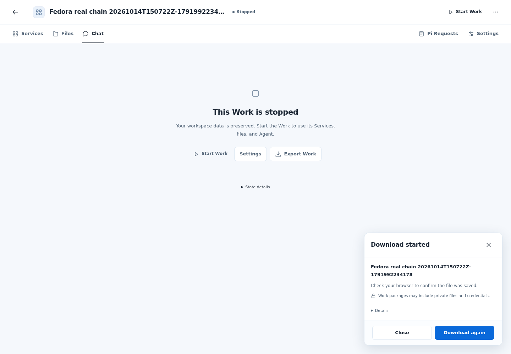
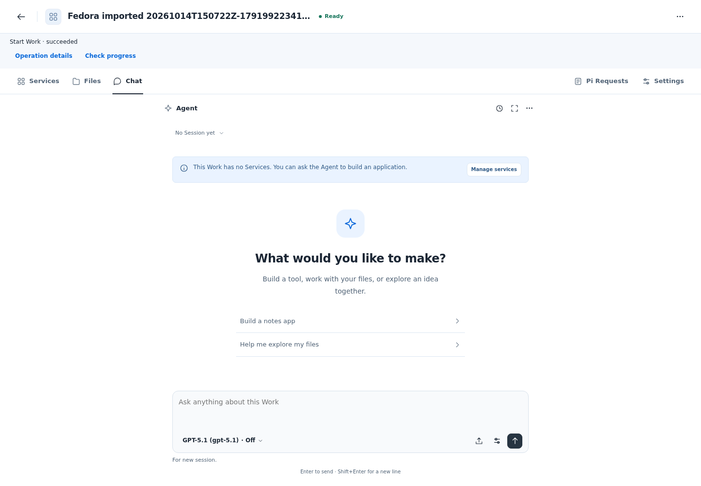
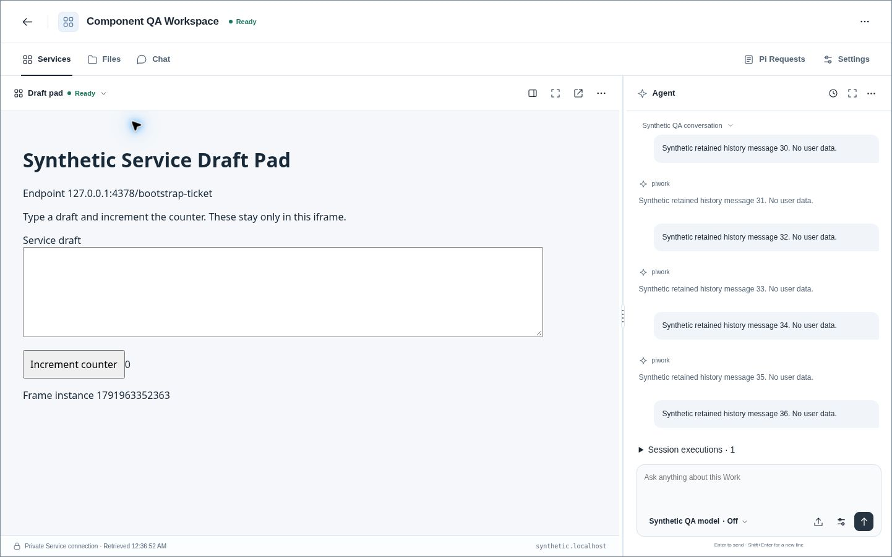
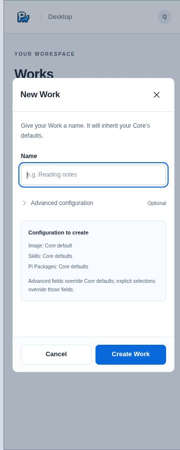
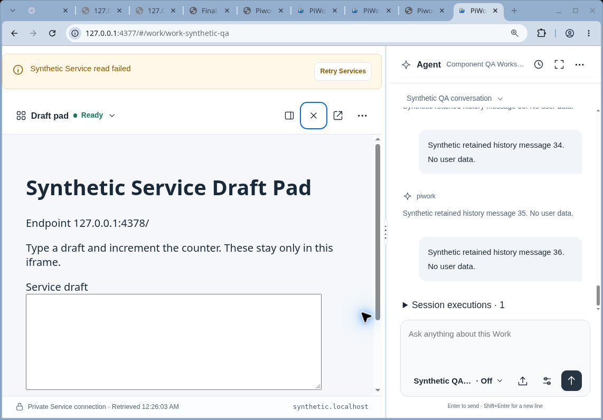

# UI 最终 Review 与 Verify 验收

## 2026-10-14 Fedora真实Docker链路与范围收尾（当前结果）

所有者明确移除原9.3真实NVDA/VoiceOver实测任务，同时要求解除NoDocker限制并完成真实Core链路。原读屏项从范围及计数中删除，不伪记为已测；键盘、焦点和可访问名称保护保持。**当前任务94/94，10.3已实际通过并完成限定安装清理。** 下方NoDocker与真实Core未测均是此前阶段的历史条件，不再约束当前工作。

### 实际环境和参与者

- 主机：`root@192.168.14.134`，Fedora，Docker Engine29.6.2，SELinux Enforcing。使用独立Core安装 `installation-4b1aab13b35966b392d4ad1288e632be`、专用端口、私有数据目录及合成账号；既有Core/Work保持隔离。
- Core和Desktop CLI使用本次Go1.25.5原生构建；基线 `9262b89`，含本次本地修复，真实 `modified=true`。Core二进制SHA-256 `8298c3bb0f9ff14efd5ac7700a9a1fd3f3a00b89b6a7d3c2b6896f95efea30d5`；CLI二进制SHA-256 `9fa57eff92da27e724cc73b9de69e8081c023d021d9000afa8d2e37f6086a510`，DesktopUIHash `d3f4d1e6bbb0bc754945eb7d51e089ecf692713f36e20160a9a65c85c122f145`。
- 真实生产镜像版本 `0.0.6-ff37c45b7093-1b352aec0357`：Agent/package-helper镜像ID前缀 `9665f2b5b274`，file-helper `2af75c7a80dc`，snapshot-helper `52f3dd1c7d1d`。实时Engine事件记录实际start：package-helper5、Agent2、file-helper6、snapshot-helper8；不是合成Core响应或仅镜像标签检查。另有合成只读Pi Package经真实package helper安装成功。
- Chromium140.0.7339.186运行真实Desktop；Core/CLI位于Fedora，测试端口经SSH转发。使用合成文件和模型凭据，本链路未发送模型Run。Core完整delivery readiness六项均ready。

### 链路、身份和请求次数

| 阶段 | 实际结果 |
| --- | --- |
| 创建与文件 | 原Work `work-0513555e-58fa-4660-b596-6af9aaa57598`真实ready；85字节UTF-8文件和8193字节二进制经Core/file helper写入、读回一致 |
| Stop and export | UI确认后Stop、Export实际成功；原Stop `operation-d0dbf803fee2869164e47b69931e98c8`，Export `operation-edcaa243b64cd3b4d292742c631317da` |
| 原快照与下载 | snapshot `snapshot-1584555a-7645-4a98-9644-8525b033c0d4`与transfer `ea3399be-da7d-4f6a-af9d-8a3da5630a0b`精确绑定原Work/Export；Core、准备结果和真实浏览器下载均为609783482字节，SHA-256一致 |
| Inspect与Import | 浏览器选择实际下载的包，Native CLI完整Inspect通过；Import `operation-2c3e1cff79148a84241a73b3f3572615`发布新Work `work-27ce5a16-a46a-4cfe-b05b-7d7c0e9adbf9`为stopped，用户确认启动前Start请求为0 |
| 显式Start与恢复 | UI选择Start and open一次，Start `operation-40b0b7c46485718d2072db33c1604223`成功，Work真实ready；两份文件逐字节及SHA-256与原数据一致 |
| 撤权 | 通过测试安装的operator禁用合成用户后，原token访问Core文件及snapshot content均401；浏览器同源fetch原已准备下载内容为404，旧内容不交付 |
| 次数 | 最终浏览器bootstrap范围内Stop/Export/prepare/自动content各1，Import及显式Start各1；撤权后的拒绝探测单列，不计作第二次自动交付 |

完整下载包SHA-256：`8b004184f49c1b7ebfce88a461dc14cc9fcc4a3b08659b8be03a6f317c36cbc7`。`验收笔记 100%.txt` SHA-256为 `a7194c9394b2955b86c909b238c92595d86358512650b9e23b1c8909a1f8cad7`；`payload.bin`为 `7e3691790cd64b19d4edb1a80e988214515abeb53aa0f34ffbfe4b4bf405d120`。

### 环境准备、观测和清理边界

- 原生服务可执行文件放标准可执行目录并恢复默认bin_t标签；测试共享数据目录使用container_file_t，独立DOCKER_CONFIG及用户凭据目录。SELinux始终Enforcing，未关闭系统安全策略或修改生产安装配置。
- 前期夹具问题包括私有凭据目录模式、命令菜单的menuitem语义、凭据复用、Node不解析desktop.localhost以及Docker仅保留有界历史事件；均保留失败结果。最终用真实浏览器同源请求、当前bootstrap范围、专用Desktop端口HTTP请求行及实时Engine事件核对；不将前期失败记为通过。下载导航不依赖Chromium普通page request事件来计数；数据传输保持真实Core/CLI路径。
- 实际测试脚本、最终退出码0日志、完整结果/请求行/Engine事件、源构建信息及清理摘要保存在忽略的 `dist/real-core-fedora/`。临时流量采集仅限定本次专用端口；原始捕获含测试会话数据，仅保存在私有测试目录并随精确目录删除，公开证据仅保留合成身份、路径、状态和hash。
- 测试Core正常退出后，逐项核验installation标签再移除剩余2容器、2网络、18卷；本次容器/网络/卷均为0。原4个容器ID和running状态保持，原Core完整ready；精确测试目录、测试二进制、观察进程及SSH转发已清理。没有全局prune或清理其他安装。
- 本次完成真实10.3，不将其扩大为所有模型/Service业务组合或未要求的读屏认证。既有844项UI矩阵与本节真实Docker结果分层记录，未合并/发布/归档。

真实停止态导出与显式启动后的新Work（仅合成数据）：

原图SHA-256：`fedora-real-export.png`为 `1e6ded8311074b658c00268ade347ed2600cdc7bedaca017ed61529b05a3d92f`；`fedora-real-import-start.png`为 `324713b1dac6486fecc45d4625a14a21480f0435c3834e9635c2a548d785b37b`。

## 2026-10-14 本机 Apply：焦点归属与取消观察测试

本节记录本机后续修复结果；下节837项浏览器及407项原生矩阵保留原环境、原输入和原构建身份，不转记为本轮通过。

### 输入与修复

- 修复基线 `9262b89abf580fc5244a919aabd5059ab7b8abe8`；修复源码、测试和规划尚未提交。修复前完整浏览器实测835通过、2失败、0跳过；Chromium140与145定向均复现原键盘焦点失败及晚装测试时钟的取消观察失败。日志位于忽略目录 `dist/verify-desktop/`。
- `app.ts`复用DOM协调前的焦点归属与modalChoice，在同一有效Response settings上下文内原控件因禁用/移除而失焦时调用已有合法回退；当前已有用户焦点时不抢回。没有新增focus timer、焦点陷阱、设置提交或Modal动画。
- 原取消观察用例在应用创建轮询前安装虚拟时钟，并等待取消接受及其立即读回结束后再改变服务端合成状态；增加真实时间对照、原requestId实际GET、取消POST一次和终态后停止详情GET的断言。生产取消和轮询逻辑未修改。
- 新增composer/关闭/另一浮层/Session/Work/身份六类晚能力读取焦点对照，并保留原IME、Tab/Escape、草稿/选区及PATCH/Run计数。早期新增composer夹具误预期移焦后Popover仍打开，按既有非模态移焦关闭行为修正断言；未改变产品关闭规则。

### 本轮实际检查

| 层次 | 结果 | 边界 |
| --- | --- | --- |
| Chromium140模型设置组 | 26通过、0失败/跳过 | 包含原失败键盘路径、控件仍可用/重复更新及六类晚结果焦点对照 |
| Chromium140取消观察组 | 4通过、0失败/跳过 | 虚拟/真实时间，关闭观察及身份隔离；真实时间覆盖终态后一个以上轮询间隔 |
| Chromium145两项修复定向 | 9通过、0失败/跳过 | 与修复前同版本对照，不等于第二浏览器的完整矩阵 |
| 完整test:browser | 844通过、0失败/跳过，退出码0 | Node24.20.0、Chromium140.0.7339.186、本次Linux CLI；真实五分钟票据过期用例300850.737ms，完整命令311782.692ms |
| Go相关契约 | CLI、client、clientfs、workpackage通过 | desktopassets编译通过但没有测试文件，不沿用前轮407项总数 |
| typecheck/build/嵌入 | 通过，25项字节一致 | 正常make build-cli构建Linux/Windows；Windows本轮只编译，未执行完整原生浏览器矩阵 |
| 边界/格式 | native boundary、repository docs、OpenSpec strict及diff检查通过 | 无Core/API、依赖、系统安全配置修改 |

本轮首个完整命令为843通过、1失败、0跳过：真实票据过期用例在创建Desktop时收到 `Desktop control channel is unavailable or incompatible`，尚未执行到等待/到期断言。失败夹具保留了监听server而未退出，仅终止本次已核实PID/命令行的卡住测试进程后命令结束；原日志保存为 `dist/apply-desktop/browser-attempt1.log`。后续以相同源码、测试和宿主输入，在Go契约测试结束后独立重跑完整入口，实际844项全部通过；不将首轮失败改写为通过，不清理其他安装的控制通道。未定位首轮控制通道失败的具体系统调用，不据一次重跑成功宣称该夹具永不波动。

宿主构建如实记录基线commit及 `modified=true`，Go1.25.5；DesktopUIHash为 `d3f4d1e6bbb0bc754945eb7d51e089ecf692713f36e20160a9a65c85c122f145`，Linux二进制SHA-256为 `9fa57eff92da27e724cc73b9de69e8081c023d021d9000afa8d2e37f6086a510`。实际源码/测试hash和命令日志在 `dist/apply-desktop/`；后续文档更新不改写该构建身份。

本轮Review核对焦点所有权、禁用/移除回退、非模态退出、主动移焦和对象/身份晚结果，以及测试时钟安装、受理后读回、原ID/请求计数与终态停止观察。23.1—23.3完成，当前93/95；任务9.3真实NVDA/VoiceOver和10.3真实Core/Engine/helper链路继续未验。本轮使用合成HTTP及原生CLI契约，不执行Docker、部署、推送或归档。

## 2026-10-14 冻结需求后的最终验证（前轮环境记录）

变更：`fix-desktop-task-completion-and-ux`。本节保留前轮环境结果，后续本机修复状态以上节和tasks.md首部为准；下方更早结果继续保留，不能混算通过数。

### 输入、范围与结论

- 最终源码与测试输入：`4205172815ff0204d097eb1eadf4032c32a6d909`，工作树干净；代码树 `f12ddba6c0b8635609fcd99d5c520ae30c6b5f82`。正常 Node 24 构建、Go CLI 宿主构建使用同一输入，不回写构建身份。
- 实际 linux/amd64 CLI：Go 1.25.5，`modified=false`，DesktopUIHash `9f64f9b7983e160ec4f72a98699c54bc1f90cd8f6b4189a9aa63e88c6dacf798`，二进制 SHA-256 `9ac3c2b76a61980a8ebc42123e853c89091e3631560bcd15d5301be87da8d341`。
- 只处理当前 UI、Desktop adapter、测试与嵌入资源；不修改 Core 业务/API、权限协议或安全边界。没有启动 Docker，没有修改系统网络/安全设置。
- 通过官方云端终端启动已安装 Chromium 154.0.8037.57 与原测试入口；此前执行环境的 UNIX socket/浏览器启动限制与本轮实际可用入口分别记录，不把旧启动失败计为产品失败。
- 独立代码 Review 覆盖 `28bfdfa` 到本轮最终实现；已证实问题均修复，当前无剩余代码 finding。全部测试源码并非每行逐字审阅；安全断言、原 ID、请求计数及失败恢复未因迁移 UI 而删除或降低。
- **UI 完整浏览器矩阵与原生契约已通过。整个 OpenSpec change 仍不宣称全部验收完成：真实 NVDA/VoiceOver、隔离真实 Core/Engine/helper 链路仍未验证。** 不合并、不归档，也不将不存在的远端 CI 检查称为绿色。

### 实际命令与结果

| 验证层 | 最终结果 | 证据边界 |
| --- | --- | --- |
| Desktop 完整 `npm run test:browser -w @piwork/desktop-webui` | **837 pass / 0 fail / 0 skip**，退出码 0 | Node 24.19.0；`PIWORK_TEST_BROWSER_BIN=/usr/bin/chromium`，`PIWORK_TEST_TICKET_EXPIRY=1`；真实等待 300250ms 的未使用票据过期用例通过，不缩短产品 TTL |
| 原生 Go 契约矩阵 | **407 pass / 0 fail / 1 skip**，退出码 0 | `go test -p 1 -count=1 -mod=readonly -json -timeout=8m`；CLI、assets、file/helper/protocol、snapshot/tree、workfiles、clientfs/client、workpackage；仅真实 SELinux 宿主条件用例不适用 |
| 补证浏览器矩阵 | 18/18 通过 | 导出交错、仅图片草稿、导航/菜单/设置/布局及焦点；这是完整矩阵的子集，不能另加成总数 |
| 焦点与重复提交定向 | 7/7 通过 | 慢刷新成功/失败/主动移焦、双击、Enter 后点击、危险确认不接受泛 Enter、逐层退出；完整矩阵包含它们 |
| Desktop typecheck、正常 build/宿主构建 | 通过 | 实际构建身份如上；25 个嵌入资产逐字节一致 |
| native boundary、repository docs、`git diff --check` | 通过 | 没有将 UI 修复扩成后端修改 |

原生测试在隔离测试子进程使用 umask 022，未改变全局权限配置。较早并行候选发生一次磁盘可用量采样时序失败；保留该失败，原断言 20 次复验及最终 `-p 1` 全矩阵通过，不修改生产容量判断或降低断言。较早浏览器 62/7 项失败的诊断也保留，不冒称第一轮已通过。

### 按模块核验

| 模块 | 本轮纠正及验收 | 范围 |
| --- | --- | --- |
| 导出/导入 | 原 Operation→snapshot→transfer 精确绑定；Close/换 Work 不取消一次交付；丢准备回复、GET 先 ready、晚 POST/重复 GET 不重放；真实浏览器 download、全部字节/hash/文件名及各一次 Export/prepare/content；Import 后显式 Start 的 failed/unknown/真实 Ready 门槛 | UI/adapter 与合成 HTTP、原生包契约；不冒充真实 Core 整链路 |
| Work/Chat/Service | 独立窗口保留缺失对象与合法端口恢复；无可用 Service 首入 Chat 不覆盖新选择/弹层；Starting 不误给快捷 Open；普通显隐保留 iframe、文本/图片及布局；仅图片草稿真实 beforeunload 取消/清除/身份隔离 | UI 与当前会话内状态，不新增自动业务操作 |
| Files/设置 | 非 207 的 408/5xx 写入保持 unknown；原路径只读核对、不重复写；慢刷新保留原按钮焦点，主动移焦后不抢回；命名 selection/IME 事件 guard、双击和 Enter-click 单次写；三来源设置返回、Save/Apply 分离、晚结果不改新草稿 | Desktop 交互/恢复，既有安全锁不放宽 |
| 菜单/布局 | 独立 app 移除无意义的 Chat/split 命令；Late read 不关闭新菜单；Service picker 按真实状态解释不可用且不自动 Start；窄断点切换时 Agent 不先隐藏丢焦点；Modal 无动画 | 现行组件语义，不新建设计系统 |

快/慢读取都采用原位反馈，缓存内容不卸载；首次数据使用无文字的局部占位。失败保留原因及显式恢复，不显示虚假的完成状态。独立 app 不增加 Chat，也不新增首屏 iframe load 遮挡。

### 基线红例与当前绿色证据分层

- 旧 snapshot 选择最小复现抽取 `28bfdfa` 的原 find 表达式，两种排列确定性选错原目标；停止态多段接力的既有基线失败记录继续保留。
- 旧导出交错最小复现忠实编译/抽取原 handleAction/checkDownload/downloadSnapshot：Close/换 Work、丢准备回复后 Check、GET 先 ready 等出现原交付 0 次；同时保留成功直返与不抹 ready 的对照，不谎称旧实现每种交错都重复下载。
- 这些旧版复现采用合成 observer/DOM 状态，不是运行旧完整浏览器。当前绿色证据来自实际 Chromium/真实 HTTP download，明确验证原 ID、次数及文件内容。
- 窄断点 CSS 因果对照采用真实样式及独立 DOM：在 resize 渲染尚未加 narrow-chat 的状态，旧样式隐藏 Agent 并丢焦点，新样式保留可见/焦点；service-only 两者仍隐藏。它不是对全应用竞速的稳定重现声明；完整应用逐层 Escape 和跨宽度焦点测试另行通过。

### 使用与限制

- 无已知 Operation 的外部 Work 变化仍可读取更新；刷新失败保留旧内容与搜索。页面内离开与原生 beforeunload 均保护有效文字/图片草稿，取消留在原页面；浏览器进程崩溃、系统强制关闭不保证草稿持久化。
- 下载成功的 UI 边界是 Download started，不等于用户已保存到硬盘；显式再次下载使用同一原 transfer，未知写入不可盲重放。
- 原统一配置读取、匿名 Inspect、原生授权/到期、隐藏与取消观察、晚身份回复隔离均保留在最终完整套件。
- 真正读屏、真实 OS 中文输入法的人工行为不由合成 composition/229 事件代替；真实 Core/Engine/helper 验收依任务 10.3 继续未测。当前 NoDocker 约束不变。

### 最终实际图形几何

- 最新冻结资源实际跨 iframe 拖动，比例 70→49，主区宽度 785.39→548.03px；拖动中遮层存在且 iframe pointer-events=none，真实 Escape 取消后遮层 0、pointer-events=auto，释放后仍无残留。
- 实际键盘方向键、Shift、Home/End/Enter，以及 1440→500→360→1440 往返，宽屏比例 60 与主区 855.59px 恢复，无页面横向溢出。窄屏全宽显示不改写宽屏比例。
- 普通、Chat 隐藏、Service/Chat 聚焦、独立 app、Degraded/错误条和高度变化代表组合均检查内层滚动与底边；原生 Chrome 125% 缩放（devicePixelRatio=1.25、907×564）时底边贴合、composer 可达，无全页横滚。
- 真实正常/减少动态参数化测试与无动画样式证据共同覆盖对应要求；不绕过浏览器被组织禁用的 DevTools，不假称手动切换了该浏览器的减少动态设置。

### Modal 适用范围验收

当前适用 family 的 21 条实际观察结合共享页脚生产契约与完整浏览器矩阵通过：窄屏 Requests、Package Install、New Work、Files 命名/删除、Import、Service Stop 和危险确认均覆盖宽/360px。直接页脚为 min-height 40px、13px 字体、8×16px padding，主/次/危险角色及 disabled/Tab 保持；长 Reset browser access 标签窄屏换行到 51.78px，不为一行文本强压点击区域。

Session 选择是 Popover，Run/Operation/Package 详情是 Drawer，Export 是明确非模态进度面板；不将这些控件强行作为阻断 Modal 验收。矩阵按现行适用 family 加生产契约组合，不声称手动打开了每种 payload、每个 Copy/Move/Overwrite 内容或每个 Import 阶段。

最终任务为 **90/92**；仅 9.3 真实 NVDA/VoiceOver 和 10.3 真实 Core/Engine/helper 链路仍未完成。OpenSpec strict/schema 通过不能替代这两项实测。

### 最终截图（合成数据）

宽屏 Service + Chat 与可拖动分隔线；Service 内容为测试草稿板，不代表用户 Work。

360px 新建 Work：表单、直接页脚及 40px 按钮。

原生 Chrome 125% 缩放及合成读取错误：错误恢复可达、Chat 内部滚动、底边贴合。

### 原始证据

完整命令日志、837 项 TAP、Go JSONL、构建身份、实际截图/几何、独立 Review 及逐场景 Verify 表随本轮恢复包保留；临时材料位于忽略目录，不向源码提交凭据、用户数据或工具链。所有图形验证均使用明确标注的合成数据与冻结产品资源。

---

# 2026-10-13 main 整合验收（历史）

日期：2026-10-13 UTC。变更：`fix-desktop-task-completion-and-ux`。本记录只列本次恢复环境重跑结果；[旧候选验收](previous-candidate-acceptance.md)中的通过数、截图及构建身份均不转移到本候选。

## 基线与范围

- 整合基线：`28bfdfa56b4c84b10ade9a63fedb7c2b75c04a90`。旧提案基线：`8b49c2cec1c6708a601d1809a97f81491525d81d`；两者相差28个上游提交。
- 冻结输入的全部67个阶段条目与前像已校验，五组层叠等于53个最终文件；没有直接用旧文件覆盖main。依A导出、B连续性、C控件/导航顺序三方整合，正常build生成嵌入资源。
- 源码/测试冲突位于 `adapter.ts`、`app.ts`、`public/style.css`、`test/recovery.test.ts`；上游新增恢复测试与本次新增测试均保留。生成资源不手工解决冲突。
- 保留上游Stop and send、独立活动Run、Service请求及回复读取、原submissionKey恢复、点击目标快照、名称错误、过期授权响应隔离和Run执行错误。独立只读复核未发现上述行为回退。
- 旧B全局Create pending锁与上游显式改名并发行为存在冲突：现保留不同名称的新显式提交，同名pending及任何未知创建继续锁定，保留latestCreateToken与草稿revision，并增加纯函数回归。
- C取消互斥叠加在上游完整请求观察链上；不恢复旧分页/Retry实现。测试夹具补全现行 `runIds` 字段；观察投影测试继续执行生产renderer及其新增名称辅助函数。
- 三个OpenSpec delta逐Requirement三方整合，保留新增上游命名、聊天中断、导入命名及Service请求展示约束，并去除重复段落/Scenario。主规格和其他change未修改，不归档。
- 根 `docs/` 不重建。仅本次必要[使用说明](usage.md)与验收记录归本change。
- 不改Core/API、依赖/锁文件、凭据、安全设置或用户数据；没有运行Docker。

## 候选身份

实现提交顺序：

1. `9784d98dd76a7f99b68a836f1d41407040e5e478`：精确导出与单次交付
2. `3d7557cbb16bfa6961b8362b265750c6d94115a5`：工作区连续性与文件结果恢复
3. `3dfbd17e9f473666199624bf99919b718507adc5`：上下文导航与完成控件

44个实现/测试/生成变更的排序清单（path、SHA-256、bytes）的排序JSON（Python默认分隔符、不含末尾换行）SHA-256：`96c8495cd8b67059e8c0ce4b798206197e64248e59f6e2ddf3c28c7e43822b46`。

供定向GUI复验的只读asset清单排序JSON（Python默认分隔符、不含末尾换行）SHA-256：`b6998f6322dcc1a7e320d5f5af182c87516684d681275d16bd982bd3d2aaa504`。该快照不随文档更新改变。完整文件清单、命令日志和恢复包单独交付。

## 本次已通过

| 层次 | 实际结果 | 说明 |
| --- | --- | --- |
| 依赖准备 | 原 `npm ci` 成功，未改package/lock | 初次默认缓存目录不可写，改用任务内缓存；没有修改系统设置 |
| 工具链 | Node24.19.0、npm11.9.0、Go1.25.5、OpenSpec1.13.2 | Go下载使用官方校验值验证，工具仅安装于任务目录 |
| A定向纯函数/adapter | 159 pass，0 fail/skip | A阶段源码；最终集成另列 |
| B定向纯函数/adapter | 216 pass，0 fail/skip | 含新增创建并发边界回归；最终集成另列 |
| C最终纯函数/生产函数/adapter | 303 pass，0 fail/skip | 16个测试文件；包含A/B、导航竞态、取消锁和观察投影，不是浏览器测试 |
| 工作区类型检查 | 全7 workspace通过 | 按现有依赖顺序先build declarations |
| Desktop测试编译 | `tsc -p apps/desktop-webui/tsconfig.test.json`通过 | 包含保留的上游浏览器回归，编译不是执行 |
| TS contracts | 40 pass，0 fail/skip | 含cancel-and-send及Retry原键契约 |
| 正常Go构建 | `bash scripts/build-go.sh`通过 | 全部7个Go入口；保留 `-buildvcs=true`，显式指向本worktree的Git目录修复环境VCS发现问题 |
| Desktop embed | 20个文件与正常dist逐字节一致 | 未手改JS/CSS生成副本 |
| Go CLI传输/文件定向 | 14顶层测试通过，含subtest共17，0 fail/skip | 原snapshot/session、传输校验、清理、文件桥接、图片、未知结果及离线Inspect等；不是真实Core |
| 新上游Go CLI回归 | 3顶层通过 | 名称错误安全投影、允许路由与cancelRunId/Retry原键、聊天输入原键 |
| Go agentclient/contracts | 9与12个顶层测试全部通过 | 细分subtest分别23与7260；不以子项数宣称端到端覆盖 |
| Go client/clientfs/workpackage | 三个package通过 | 同批CLI完整包结果仍失败，见下方限制 |
| 文档治理 | checker及7个相关测试通过 | 当前54份文档、1份迁移清单；没有复活根docs |
| 原生边界 | checker及1个测试通过 | 扫描不代表原生Desktop运行成功 |
| OpenSpec | `validate fix-desktop-task-completion-and-ux --strict`通过 | 只证明格式/结构有效，不表示全部任务完成 |
| Git | `git diff --check`通过 | 未远端推送、发布、合并或归档 |

首次C纯测中5个观察投影测试因旧夹具未加载main新增的 `importNameFeedback` 失败；补为读取并执行生产函数后重跑303项全部通过，没有改变产品逻辑来迁就夹具。

## 未通过或未验证

- Go完整 `internal/cli` 包本轮失败：相关测试报告 `netlinkrib: operation not permitted`、原生Desktop无法启动及control channel不可用。未更改权限或绕过限制。其他三个包通过不能描述为该完整命令通过；后续有明确选择范围的CLI契约测试另列。
- 原仓库Playwright启动：先缺少浏览器，可通过官方项目依赖安装Chromium140.0.7339.186；正常重试后启动仍因 `socket() failed: Operation not permitted` / SIGABRT失败。选中的3个上游授权隔离浏览器回归均在before hook失败，产品断言0执行。清理hook因browser未创建而失败、server未关闭，使用25秒外层时限结束；没有改安全参数、使用raw CDP或绕过socket限制。
- 完整Desktop `test:browser`、原生 `browser.test` / `native-auth`、真实Core停止→导出→校验→下载→Inspect→Import→显式Start链路均未通过本轮完整验收。保留相关测试源码及未勾选门槛。
- 本轮不重复已被审批阻塞的真实Import/file chooser操作；不把合成HTTP、纯函数或GUI演示等同于真实Core结果。
- 360px全矩阵、实际NVDA/VoiceOver、完整键盘/几何/动效矩阵仍未验。任务表维持28/45，不因partial结果勾选剩余17项。
- 仅准备Draft PR，不能据此宣称全部Spec全绿或可直接合并。

## 定向GUI

通过受支持的官方GUI工具操作云浏览器，使用冻结asset及独立合成HTTP后端，以下5组定向复核通过；逐文件manifest均匹配。它们不代替整套仓库Playwright或真实Core验收。

1. 临时503连续性：原iframe保持相同文档/UUID，应用输入保留。
2. Files与命名：12个选择命中区均为32×32；选择前后行位置差为0；Rename初焦且仅选择文件主名A。
3. 轻量关闭与脏导航：Work菜单外侧关闭并返回焦点，Stop影响确认外侧不关闭；Back/Forward保留脏文件确认与草稿。
4. Start完成出口：Start POST为1；原 `operation-start-1` succeeded但Work仍Starting时无Open，Work Ready后才提供Open；不自动离开Works，Service entry POST为0。
5. 停止态导出：原 `operation-export-current-1` / `snapshot-current-1`，Export/prepare/content计数为1/1/1，Stop为0；实际浏览器下载9163字节，SHA-256为 `2b9e7538f91fbfe087ad0cfa0080e30e3480f3d40136997c3121f47dd54788ca`。未把Content GET等同于真实Core生成/完整性链路。

GUI使用的 `app.js` SHA-256为 `a8cf325f050e5911304222183944cfbd6de8e76319b55afc6609af6d17caf25a`；`asset-manifest.json` 原文件（含末尾换行）SHA-256为 `8810639ca2c3f8a2f15e2f25f7cac25df02255725da0b40e863ab0a9725e5562`。

## 2026-10-13 用户反馈增量：主流程与管理入口分层

### 基线与修改

本轮开始时只读确认PR #2仍open/draft且未合并，远端head为`615e7d92432cf1218d4d292bb164a993ca5e9393`，base仍为`28bfdfa56b4c84b10ade9a63fedb7c2b75c04a90`。本地`d9e633d`树与该远端head相同，工作树干净；不覆盖其他提交。用户三张反馈图已实际查看。

- Works/Work：Ready行直接Open Work，Stopped保留Start；Stop与Work information归当前Work更多菜单，移除Work顶栏About图标；删除列表底部重复Create a Work，空列表引导保留。
- Admin：全局About与Known operations归账号下拉；外点和Escape只收起菜单，不受背景草稿/任务阻断，不扩大危险确认白名单。
- Export：原入口本来就直接建立一次新意图，本轮不重写协调器。改为非遮罩紧凑进度/结果，技术ID、旧快照、Pause/Check按需展开；成功保留同文件下载，明确失败保留原快照Retry download，未知结果只读核对；running仍有Stop and export影响确认。
- Files：移除空选择提示条；批量图标放入原工具栏，选择命中、覆盖/删除/未知结果保护不变。
- Service/Agent：请求入口用有aria-label/title的就近图标；Service仅可靠hasRecords时显示且保留当前Service过滤，Agent保留全Work范围，无计数或新API。

只改Desktop源码、对应测试、正常生成的嵌入资源和本change材料。未运行Docker，未改Core/API、依赖/锁文件、凭据、安全设置；不发布、合并或归档。

### 本轮实际验证

- 17个纯函数/生产renderer/adapter测试文件：321 pass，0 fail/skip。新增18项覆盖新层级、停止态直接导出、running确认、在途去重、准确旧快照、failed准备重试、dialog模态切换、Admin身份转义、批量工具栏与图标作用域等；这不是浏览器通过数。
- 全7 workspace typecheck与全部Desktop测试编译通过。原browser/native-auth/feedback/recovery/real-core测试定位器按Admin及Work更多菜单迁移；新增360/500px回归源码已编译，未声称本地Playwright实际运行通过。
- 正常Desktop build、Go1.25.5全部入口构建通过；20个嵌入资产与dist逐字节一致。Node24.19.0；没有为构建修改项目依赖或安全参数。
- 文档治理、native boundary checker通过；两个checker测试文件合计5 pass。OpenSpec strict与git diff --check通过。
- 独立只读review发现并修复failed下载准备的同snapshot恢复缺口、账号标题转义及旧测试入口迁移遗漏；新增回归没有删除旧安全断言。

### 官方云浏览器定向复验

使用独立合成HTTP夹具与冻结正常构建资产，不接真实用户Core。最终`browser/app.js` SHA-256为`4fed5167039aabeeb4216b7802fbcbb65761fd9067a155832c80dd24b9a2f82a`，`public/style.css`为`ac7a157cecef9ded380c5d429f26410292efa7eb06053718c21e50047eaf95fd`。

- Admin外点/Escape关闭并回焦点，About/Known可打开，底部重复创建CTA不存在。Known operations读取pending时仍可外点收起，gate释放后不重新打开，零业务mutation。
- 已存在两份snapshot时，首次Export只有一次点击；Export/prepare/content为1/1/1，实际下载9163字节并匹配本次current内容，未误用旧snapshot。紧凑卡片非modal，Details默认折叠，背景Search可输入；背景New Work能正常切换回模态窗口。完成后再次明确Export只再新增一次新意图，两次明确操作合计Export/prepare/content为2/2/2，Stop为0，两份包均9163字节并匹配各自当前内容。
- 两类请求图标均有title/aria-label，Service入口保留原Service过滤。
- Files宽屏与500px首次选择、末次清空行位置保持不变；500px A行Y均251，复选框label32×32，scrollWidth与innerWidth均500；批量Copy打开原A.txt/B.txt目标。500px Work更多菜单和Stop影响确认可达。
- 首轮窄屏实测曾发现两行工具栏被父flex压至57px、原first-child隐藏规则误隐藏唯一Work更多按钮；两处已修，最终冻结重新测量并截图确认，不沿用失败截图为最终结果。

### 仍未通过或未测

原45项中28完成、17未测状态保留；新增层级工作另列11.x。最小可用官方Chrome窗口实际innerWidth为500，360px实际GUI未测，不能以新增回归源码或CSS推断通过。完整键盘矩阵、真实读屏、原生授权与真实Core停止→导出→校验→Inspect→Import→显式Start仍受原门槛约束。

一次较宽的测试命令误包含需本地浏览器的feedback/preferences/recovery夹具，初始化未完成，后中断退出130；这些失败/未执行不计入321项通过数。随后按17个不需浏览器的文件明确重跑成功。未绕过既有浏览器/socket限制，也没有把官方云浏览器合成GUI替代整套browser/native-auth或真实Core验收。

## 2026-10-13 后续完整界面范围：工作区层级与一致控件

### 输入与实现身份

本轮接续PR #2的已确认Draft候选（远端输入`f6b9a84172c6048cb76e05ea3b2da204ead445f1`，本地`4eb0e3f`同树`411faad55c9a8fa48b46df41253f12481c3f74b7`）。完整11模块范围先更新本change的proposal/design/三个delta/tasks，文档提交`5249c14fa65aeacdf88f4e49cc5ee498cab60b8f`；随后按功能实施，原17项未测保持原状态。

| 本地提交 | 边界 |
| --- | --- |
| `b1561e3e8a63b0e3eb6e725799d4fca95265740e` | Work级请求检查、真实Run上下文、Service选择器、稳定分栏与实际高度 |
| `e7414658491b833968a8060cca983fe9c3188c76` | Files/Settings/Works/Admin减重、active Run与窄屏可达性 |
| `b1d53d06e6894559242ddb1f336c8a8925ea8053` | Modal展示状态机、footer几何与角色、Stop装饰、等待与Apply状态 |
| `c1faaf475bfa8934abc9643c10ba20bc2d372d44` | 浏览器发现的快速重开吞点击、Files模板括号、unknown Apply原ID保护 |
| `31516d5ace5e0e6a9e0cf3f61c25db74e266d516` | 退出后已恢复composer光标与导航期间Apply受理原ID |

最终功能tree为`eb284faea74c1b630015dde3ea5769a8e360186c`；后续仅文档提交不改变功能资产。22文件冻结清单原字节SHA-256为`da67ab11c9dcda1ea2cee28614d2352b74a2d3750db94380cf24f8b736627b48`，`app.js`为`195c9276d4e5cb6c4265c4af48e2845f03534d159ea18566ef88283c10177b37`，`style.css`为`329dd9f4438d52bed7b7425d8bcf2cc8e197d17bf5799691f049e9f405724b2e`。清单、命令日志及每次提交的path/mode/blob/content校验保存在忽略的`dist/workspace-update-delivery/`，不把旧冻结结果标成新资产通过。

### 11模块实际实现

| 模块 | 实现及事实边界 | 定向自动回归 |
| --- | --- | --- |
| Pi Requests | Work级跨Chat/Service入口，Service过滤保持；右侧列表/详情保留来源上下文；目标/结果优先，Executions/Technical details折叠 | `workspace-hierarchy`、`pause-projection`；多Run succeeded仍保持目标waiting，terminal残留waitRef仅作历史证据 |
| Run Details | 每个真实runId一次就近入口；legacy不猜测；无消息对应的明确活动Run独立展示；confirmed-null不提供旧Cancel | `workspace-hierarchy`、`chat-projection`；外部same-session active与不同Run ID不串 |
| Service/Chat布局 | 页面内身份/Work独立比例、普通显隐与Focus分开；拖拽/键盘/重置；窄屏单面板；祖先节点不改换 | `workspace-layout`、`continuity-adapter`；最小宽度与360/500数学边界只证明函数，不冒充真实viewport |
| Service选择器 | 名称、真实状态、声明端口、选中行和管理出口统一；单/多端口分层，不自动Start | `workspace-hierarchy`、现有Service准入回归 |
| Files | 一个常规Refresh，busy/Updated原位；保留错误及未知核对；Upload/New folder归＋，WebDAV/空态保留 | `compact-work-controls`、`action-state`、`file-results`；生产files renderer检查重复入口及字面模板字符 |
| Work settings | Back位于内容左上；一致状态轻量显示；dirty/not applied/applying/failed/unknown动作保留 | `compact-work-controls`、`navigation-review-regressions`；两次Apply、恢复真实kind、unknown无ID不借旧ID、导航晚受理仍绑定原ID、身份失效不绑定 |
| Works | Refresh/Import/New图标主次及tooltip/aria；空态文字CTA保留 | `compact-work-controls`、`action-hierarchy` |
| Modal footer / Stop | footer直接按钮统一40px最小高度/间距；角色顺序；仅移除Stop假复选框装饰，Delete真框保留 | `modal-presentation`及原危险动作/文件准入测试 |
| Admin | 一次账号身份，明确Role/Core标签；收起不受背景草稿阻断 | `compact-work-controls`、`action-hierarchy` |
| 底部高度 | root按真实可用高度flex分配；内层滚动，不再减157/150硬编码余量；不修改Service业务DOM | `workspace-layout`及GUI几何，最多保留一条Service StatusLine |
| 动效与短反馈 | 140ms opacity/4px；reduced-motion同步终态；逻辑关闭立即失效，非模态inert视觉快照退出；保留具体错误/必要风险 | `modal-presentation`；choice/identity/route/node、重复完成、event缺失fallback、快速重开、新背景焦点与composer caret；Export保持非模态 |

### 自动构建与回归

以下仅列本轮实际执行，不累加历史批次通过数：

- `npm run build -w @piwork/desktop-webui`、`npm run typecheck -w @piwork/desktop-webui`、`tsc -p apps/desktop-webui/tsconfig.test.json`通过。
- 21个不启动浏览器/socket的Desktop纯状态、adapter及生产函数测试文件：最终357 pass，0 fail/skip。测试包括本轮新增的workspace-layout、workspace-hierarchy、compact-work-controls、modal-presentation；完整Playwright没有因此被视为执行。
- `node scripts/check-native-boundary.mjs`通过；native boundary与repository docs相关5个测试通过；`node scripts/check-repository-docs.mjs`通过；`git diff --check`通过。
- `openspec validate fix-desktop-task-completion-and-ux --strict`通过。校验只证明变更结构，不等于所有验收门槛完成。
- Go1.25.5、Node24.19.0通过现有`build-cli.mjs --target linux/amd64`构建宿主；最终构建身份和资产对照见下方收尾记录。没有Docker、Core业务/API、依赖/锁或安全配置修改。

### 本轮回归中发现并修正

1. 已取消Request保留历史waitRef时，原展示仍写Waiting。改为只在waiting_result/waiting_apply显示当前等待，历史字段仍可展开核对。
2. 活动接口有same-session Run但Session快照尚无记录时缺就近入口；补明确执行记录，同时authoritative null不回退旧Run取消。
3. 退出视觉节点仍处于native modal top layer，Escape后第一次New Work点击被吞。保留动画但同步解除native modal阻断，使用不可交互的非模态快照与淡出背景；旧定向GUI失败保留，修复后同流程复测单列。
4. Files＋后的模板多余字符通过实际renderer测试复现并删除；Apply恢复kind、旧Operation选择、unknown无ID和导航晚受理按真实对象分别加测试。
5. 退场回调不得抢新背景焦点或回退已重新使用composer的光标；来源已不可见时选择合法可见目标，旧identity/route/choice/node不能恢复新窗口焦点。

### 宿主与未测边界

最终功能提交`31516d5a`的Linux/amd64宿主构建通过，14253318字节；SHA-256为`4170330711cf2df149d0e38da7af3ac3dd98c84affd3b18d0fa1b0bdc0da6391`，DesktopUIHash为`e70d4c5303e7d1d74d0f7b2b82a666266c6acf5d9d7fc14352f0d02eb9581b5c`。构建时仅本change的usage/acceptance文档尚未提交，所以build.json如实记录`modified: true`；功能源码与冻结资产完全一致，22/22 build/dist/embed/frozen SHA-256相符。没有把文档dirty身份改写成clean。`internal/desktopassets`可编译但没有测试文件，不作为新增测试通过数。

- 原第1—11节17项未测保持不变；本轮没有重试此前已因环境socket限制失败的完整Playwright/native-auth入口，也没有使用额外浏览器安全参数或权限绕过。
- 真实Core/Docker、完整导出导入链路、真实NVDA/VoiceOver、360px真实窗口、完整Modal/状态/键盘/缩放组合仍未验。官方云Chrome可达窄窗口约500px，函数360px边界不替代真实GUI。
- Reduced motion仅生产分支和退出状态机的定向自动测试通过，没有本轮实际系统减少动态效果GUI证据；恢复Apply的真实kind/unknown/晚受理通过生产函数测试，不等于真实Core Apply验收。
- Files“无新增成功行”限定本轮常规Refresh读取。New folder等写入完成仍可能显示原有结果行；合成New folder完成后观察到约55px行位移，保留为范围边界，不冒充Refresh失败或批选几何通过。混合失败、未知结果与逐路径恢复不会因此被隐藏。
- 第12—16节实现均已落地。任务复选框按完整验收门槛保守维护，包含尚未执行广矩阵的任务继续待验；不能把本轮定向截图、纯函数或合成HTTP结果描述成全部规格全绿。PR继续作为Draft，不归档或合并。

### 官方云浏览器定向验收收尾

使用官方云浏览器与独立合成HTTP夹具，未运行真实Core或Docker。最终资产`31516d5a`逐文件served SHA-256为22/22匹配；定向范围无未解决FAIL。原始JSON、请求ledger和以下原图随恢复包保存，不将截图视为未执行操作的证据。

| 实际候选/场景 | 结果及可核对事实 |
| --- | --- |
| 首批`b1561e3e`工作区 | 21/21 served hash；请求过滤/Back回原行焦点；两条Chat Run各读原runId；选择器不自动Start；分栏、Hide、Focus及1180→502→1180过程中iframe与Chat祖先detach均0，document UUID/load保持1，文字和真实PNG草稿保留 |
| `b1d53d06`未受后续守卫修改的路径 | Refresh慢读、成功、失败均在本控件/错误区域正确反馈；外部same-session active Run详情与Cancel绑定原ID，取消后authoritative null移除旧Cancel并恢复Send；初次快速重开FAIL单独保留，没有将它计作通过 |
| 最终`31516d5a` Modal | Escape后立即首击New Work，3/3打开且焦点create-name；正常动画computed 0.14s；退场后新背景search焦点与输入保留，无旧窗口/假背景残留 |
| 最终代表footer | Create、New folder、Stop、Delete、Export、Request直接按钮computed高度40px；Stop 0 checkbox，Delete真确认框保留；取消查看不提交Stop/Delete/Create |
| 最终请求 | terminal Request保留历史waitRef但不再显示当前Waiting；原Request cancel 1 POST，另一Request状态保持running，无Run cancel或Service控制/Start |
| 最终Files | 普通Refresh只有1入口，成功同按钮Updated、0额外feedback行，A.txt行Y=226；＋后的多余字符已消失；首选/清空末项宽屏Y=226/226/226，500px时Y=251/251/251 |
| 最终Settings | 正常Configuration轻状态，无多余warning；Back to Work回到Files而非默认Services；真实Apply恢复/迟回跨页仅自动测试，GUI未测 |
| 最终500px普通/Focus | 普通Show Chat保留Work导航；Focus隐藏导航但Exit可用；回宽屏后同document UUID，Service与Chat草稿逐字保留 |
| 最终实际高度 | 1180×757 viewport下app/work-layout/main-panel/service-bottom底边全部757px；work-layout top=122px、height=635px，body/main底padding为0，无原35px外壳空带 |

最终合成ledger：Service entry 1次，New folder MKCOL 1次，原Request cancel 1次；Start/Stop/Service control/Create/Delete/Import/Inspect均0。它证明本次实际操作范围，不证明这些未提交动作的真实Core成功链路。测试夹具仅停止本轮自有进程，已校验processAbsent，不清理其他进程或安装数据。

除上节限制外，本轮未测试Import/上传file chooser、全部历史Modal组合、触控以及真正OS fullscreen；不将宽屏/500px与生产函数检查写为完整浏览器矩阵通过。任务表最终38/67完成，原33/50状态不变；新增5项达到本轮完整任务门槛，其余12项实现已提交但广矩阵验收仍待执行。

代表原图（合成数据、无真实凭据）及SHA-256：

- `final315-05-workspace-wide.jpg`：`235cd5240e151bf0498074e71feeccece0c8e293970e188189a41689c6f220e8`。
- `final315-06-request-detail.jpg`：`bbb1c861b8b67f3152cab1a00e6f0e9a353539e9ddd2db7e0d852bfd0d375416`。
- `final315-07-files-compact.jpg`：`30c6b1ceecfcae99d430e3577d6984e1a98062210779a938d09778f86fe2b4eb`。
- `final315-02-settings.jpg`：`3753db0c1a2f8ef60cfff9028f43798862db11975c219fff1780b2645044f96b`。
- `final315-08-stop-modal.jpg`：`479d13f567cd5e7f0194e0bbd82497eb4144ba9b470bddb142aee8f91b087580`。
- `final315-04-focus-500.jpg`：`c5b26e7268b638ef4acf8c139823d0f7120cbc14bad60532a8fea156eab36274`。

## 2026-10-13 末轮反馈：Chat入口去重与Settings对齐

用户指出最终315截图中的Chat“双放大”和Configuration in use未对齐，以下为追加修复，原315验收不冒充本次补验：

- `91d05d9abbe1f3dbe3b623c80fbde9970a30f35c`：窄屏service-chat头部原先同时包含focusControls的浏览器Full screen与追加的Focus chat，二者复用同一四角SVG。移除头部浏览器全屏入口，归入Agent/Service的⋯菜单，显示Browser full screen/Exit browser full screen文字；Focus/Restore保持主布局入口，Hide chat使用不同方向/聊天图标。菜单调用仍直接使用原Fullscreen API与错误处理，未修改执行协议。
- `d5e221a190fd085e363e55fd8e3a07cf4491532b`：Back与标题原在同一左侧块，状态与Back顶对齐，Details又被flex-basis:100%强制换行。现Back独立导航行，标题与右侧状态/Refresh/Details同排居中；600px以下整组移至标题下。Details按需展开不撑歪标题；dirty/Apply/unknown行为不改。
- 新增10项Chat布局/菜单生产renderer断言覆盖1180/500与workspace/service-chat/service-only/chat-only；新增Settings结构及CSS对齐回归。最终纯状态/adapter/生产函数368 pass，0 fail/skip；Desktop build、typecheck、测试编译及diff检查通过。既有Fullscreen浏览器测试入口同步改为先打开菜单；该完整Playwright并未执行。

补验结果：

- 最终功能冻结`1cba80bceb68af6a458f954af5c59a88fc6c2711`，官方云浏览器实际HTTP served 22/22 hash匹配。上一冻结d5的Chat代码与最终完全相同；最终同时复验500px入口。
- 1180px普通Chat头部只有一个Focus四角图标，Hide为独立箭头；Chat Focus使用Restore箭头和Exit ×。500px普通/Chat Focus/Service Focus均无头部浏览器全屏入口；Agent/Service⋯里的Browser full screen文字、aria-label、aria-pressed=false可达，未进入OS fullscreen。布局还原/折叠保持Service document UUID及草稿。
- 1180px Settings标题、状态、Refresh、Details中心Y全部231px；Back独立在上行。500px状态组统一位于标题下，组内中心Y=257.5px，scrollWidth=500。
- 首次500px Details展开发现左侧裁切，追加`1cba80bc`仅调整窄屏浮层定位并补CSS约束回归；最终浮层x=20/right=300、正文完整、scrollWidth=500，实际补验通过。失败原图不作为最终展示。
- 最终368项纯测试再跑通过，0失败/跳过；typecheck、build、native boundary、diff检查通过。宽窄对齐和入口定向已执行；OS fullscreen、真实读屏、完整Playwright及原其余未测矩阵状态不变，任务仍38/67。

## 2026-10-13 夜间小UX复核：Files按钮与键盘焦点

限定检查代表页的对齐、按钮尺寸、窄屏溢出与键盘关闭/恢复，不扩展架构、执行协议、Core/API、依赖或安全配置。前两项缺陷先由只读检查定位，再用官方GUI重现：

- Files在≤768px残留旧icon-button缩小规则：500px/768px Add为28×33，Refresh为112×40；500px Copy/Move/Delete/Clear也为28×33，顶部相差3.5px。首选前后文件行仍Y=251，不把原尺寸问题混同成行位移。
- Works搜索框内Clear与无结果区Clear search，键盘Enter触发后旧按钮随render消失，activeElement落到BODY；立即输入字符没有进入搜索框。

追加功能提交`bdda6a43ffd5f34167a0987d03472f669d63bbed`删除Files旧窄屏尺寸覆盖，回用同一40×40控件；Clear search在清空render后显式聚焦#search，两个入口共用。新增3项回归先失败，再修复后最终371 pass、0 fail/skip；build、typecheck与测试编译通过。文件行菜单、checkbox、Service/Composer按钮尺寸及业务请求协议不变。

同轮代表页扫描又实际复现第三项：普通Work模式选择Files/Chat/Settings后，区域已切换，但焦点跳到Services；Files上再次Enter会误切回Services。根因是普通导航也调用exitWorkspaceFocus，未区分是否真实处于Focus布局，随后恢复逻辑选中DOM中的首个Services入口。

追加`8f46406de4f7c6c04c503b7e9e85992a9841f6b9`：普通workspace且无当前root DOM fullscreen时直接返回，不执行虚假退出的焦点恢复；真实Focus/Fullscreen退出仍走原路径。新增Services/Files/Chat/Settings四入口与真实Focus退出回归，先复现Files/Chat/Settings三项失败，修复后最终376 pass、0 fail/skip。没有增加新导航状态、路由或协议。

官方GUI复验`8f46406d`时确认错误的Services跳转已消失，Chat可连续Enter，但Files/Settings读取期间disabled会让真实浏览器失去按钮焦点，读取完成后仍落BODY。追加`2cd3ad3835f08672a886335f4ea8f7473a21a4cf`在读锁解除时恢复原导航按钮，只对开始时实际聚焦的原入口、仍选中且未disabled、同Work/identity/当前Action record、无新Modal且当前焦点仍为BODY/root生效；已移到新输入框、换tab/Work/身份/新record时不抢焦点。

新增9项生产dispatchAction回归覆盖三个读取入口、读取失败和新焦点/tab/Work/identity/record边界。修复前4项失败，修复后最终385项纯状态/adapter/生产函数测试通过，0 fail/skip；Desktop build、typecheck、测试编译、native boundary、repository docs与OpenSpec strict通过。该测试层不替代真实浏览器焦点或原完整Playwright。

### 夜间官方GUI定向收尾

- 最终冻结`2cd3ad38`的实际HTTP资源22/22 SHA-256一致；只执行本节已记录三项缺陷的补验及代表页检查，无未解决的定向FAIL。
- Files尺寸修复在`bdda6a43`实际验证500/768/1180px：Add及Copy/Move/Delete/Clear均40×40，与Refresh同顶/底；首项选择及清末项前后500/768px文件行Y=251、1180px Y=226不变，文档无横向溢出。后续导航焦点提交不改CSS。
- 两个Clear search入口以Enter清空后均聚焦#search，紧接的q/w分别成为输入值；不需要额外鼠标点击。
- 最终`2cd3ad38`在500/1180px以Enter选择Files、Chat、Settings并不重新定位再次Enter：12次记录中activeElement始终为对应BUTTON、activeAction为自身，未落BODY或误跳Services。
- 人为延迟Files读取时将焦点移入composer并输入，释放读取后焦点及草稿原样保留；延迟Settings读取时按Tab移到Back to Work，释放后仍停留该按钮。恢复只弥补原入口被read lock禁用的失焦，不覆盖用户后来选择。
- 代表Works/账户菜单宽窄、Copy对话框及500px New Work高级长表单已查看；观察到footer40px与body可滚动，未发现需要另改的可复现问题。此扫描不作为全部模态、真实读屏或完整浏览器矩阵的通过声明。

证据按候选版本保留在本次恢复包的`night-ux-qa`中，包括Files前后geometry、两个Clear的键盘记录、导航历史失败与最终宽窄记录、慢读焦点持有/释放以及22项served hash。任务仍38/67；原17项未测及360px、真实reduced-motion、Core/Apply/完整Playwright等限制全部保持。

## 2026-10-14 截图反馈：组件语义与移除Modal动画

用户本轮先反馈Chat显隐位置/按钮语义、Files两项动作被错误放入Modal、正常配置Details重复说明及Modal残影；随后明确要求全部取消Modal动画。本轮按最后要求删除动画，而不是继续修饰退场效果。未在真实用户环境复现原残影，不将源码推断称为该截图的实测根因。

### 实现与回归

- Show/Hide chat共用Work工具栏同一面板图标按钮，始终保留同一action、aria-controls、动态名称与expanded；Agent/Service工具栏不再放重复的普通显隐入口，Focus独立。
- Files＋使用锚定非模态动作菜单；Upload/New folder保留文字，New folder才打开原名称输入Modal。菜单可方向键移动、Escape回触发按钮、Tab/外侧离开关闭；原文件写入/覆盖/未知保护不变。
- 正常Configuration in use只保留轻状态和刷新，删除无有效详情的重复Details；既有dirty/Not applied/Applying/failed/unknown生产renderer回归仍通过，Save与Apply分离。
- 移除ModalExit模块、生成副本、快照/视觉层/动画事件/timer以及全部Modal入场退场keyframes。关闭同步失效modalChoice、native close、render并恢复合法焦点；Export继续非模态。新的入口使用当前launcher，不继承旧关闭来源。
- Input options入口从错误的pressed状态改为dialog disclosure；真正Include Service identity checkbox不变。Files Move使用独立folder-move图标，不再和Back共用箭头。

针对原Files Add Modal、空Details、宽/窄Agent Hide旧位置的4个生产renderer断言先失败（29项中25通过/4失败），修复后通过。旧12项动画相关测试按新需求替换为6项即时关闭/合法焦点/无动画机制回归，另外新增9项控件语义用例；其余状态/adapter/生产函数回归保留。最终纯测试388/388通过，0 fail/skip。

命令与范围：

- Desktop build、typecheck、测试TypeScript编译通过。
- 纯测试以不含Playwright/chromium导入的全部编译后test文件运行；不是完整test:browser GUI矩阵。初次尝试全入口时6组需要浏览器/宿主的测试不具备本轮自动入口，失败日志保留，未将其记为产品回归或全套通过；官方云Chrome单独执行下面的定向GUI。
- native-boundary、repository-docs、OpenSpec strict与git diff --check通过。
- 官方Go1.25.5与Node24.19.0正常build-cli --target linux/amd64通过，21个嵌入资源（18个browser模块、3个public文件）；删掉modal-presentation后的数量不沿用此前22。功能提交c3e76aab174db6ba3d8596a6959d47ac0d46e571，第一次宿主build modified=true因为同期OpenSpec/证据尚未提交，未伪改构建身份；最终clean build身份随交付包保存。Desktop input hash：776fff73dc9c77b3bc93a0f35826abd6794b41bfeef32b60adbfc63fc80ac7e7。
- 独立只读生命周期审查确认同步关闭顺序与合法焦点检查，无延迟回调或旧退场层；不替代浏览器验收。

原第1—11节33/50、17项未测及先前360px/真实Core/Docker/真实读屏/完整状态与Modal矩阵不因本轮变为通过。未修改Core/API/依赖/锁/安全配置/Service业务UI，不同步主Spec、不归档、不合并。

### 官方云Chrome定向验收（合成fixture，不是真实Core）

- 最终冻结app.js SHA-256为a8db6b84bbcb334dddfab81be61512332c187bbf363dae36df48761cdd4fd620，style.css为ac27022cc0661615035faeb0404b1db54df59741c07e5db1c3216aebed81134d；清单含21个实际资源。
- New Work和New folder的computed animation为none、duration为0s，仍为native modal；关闭后立即零dialog/ghost节点，快速关闭再打开可用。旧baseline关闭检查未捕获永久残影，用户要求取消动画后不再保留任何视觉退场状态。
- 宽屏Show/Hide共用同一40×40锚点和class，Service内合成草稿/counter/iframe instance及Chat草稿均保留。
- Files＋动作菜单右边缘与＋对齐、位于其下6px，无dialog或背景遮罩；Escape恢复＋焦点，New folder进入真正名称输入modal。
- Input options具有haspopup=dialog、不带pressed，可键盘打开；正常配置无空Details。
- 500×900下Show/Hide按钮均为x321.656/y69、40×40，合成Service实例/counter/输入及Chat草稿保留。Files菜单右边缘490、top205（触发器下6px），无横向越界；Tab关闭菜单，外侧Services点击既关闭又完成导航，没有吞掉目标动作。
- Upload files实际打开multiple文件选择器且菜单关闭，未选择或上传文件。New folder窄屏边界x17..483，Escape回到＋。选择文件后的Move图标正确，但未执行移动。
- 证据来自官方Chrome1440×900与500×900的定向测量记录及合成截图；来源为交付包browser-qa的REPORT.md/checks.json。fixture启动时固定资源字节，startup manifest与上述hash相符；浏览器直接打开JSON manifest被客户端拦截，未绕过，也不声明独立逐HTTP响应hash巡检。
- GUI未执行真实Core/生产Service、实际上传/创建/移动/删除/发送、完整身份/修改矩阵、异常配置的浏览器矩阵或所有Modal类型；配置异常为纯renderer回归而非本轮GUI。没有未解决的定向产品FAIL。

本轮要求的界面修正均已实现并通过上述定向检查；新17.1/17.4完成，17.2/17.3保留未勾选是因为其中完整路径/身份/修改与全部关闭竞争矩阵未逐项实跑，不表示仍保留旧Modal动作菜单或动画。当前任务40/71；原33/50与17项未测不变。

## 2026-10-14 浮层职责、局部控件与规范采用

### 范围与基线

远端PR#2读取基线 `e9b6081e8ed5e7fe4692e5010f6713a3a011ed49`，本地等价 `d19506a2919c179acf578fe0368318080e9b5aca`，共同tree `47c36d824360a151a522f67a710f2eb89beddbe7`。实现提交 `3c69257773bf84d93e5e5b55dae8931f12a0a84d`，tree `d123f415f0315575185fd494ebdc4c79875c155a`。完整[入口分类](overlay-classification.md)同时列已修与合理保留，既有独立表单/危险确认没有为了视觉统一降级。

用户原文Spec逐字保存到[稳定规范入口](../../../../specs/desktop-ui-language/ui-component-adoption.md)，26944字节及来源SHA256见分类记录；原文没有复制多份。AGENTS链接此入口。其采用不表示新增设计系统、强制linter或完整无障碍合规工程。用户本轮也明确全部已确认误用在本次修完；实现包括持续Operations/Run/Package Inspector，未将这些已确认项推迟。

### 自动检查

- 最终403项纯函数/adapter/生产renderer与handler回归全部通过，无失败/跳过。新增分类、碰撞翻转、菜单键盘/非吞点击、值列表语义、Header窄屏、File Delete恢复性、Upload review、假空态、实际局部retry、真实Link、Drawer焦点、缓存metadata与身份晚结果断言。原未知写入、覆盖版本、身份/草稿/iframe、Stop and send、导出原ID等回归保留。
- 全7个workspace typecheck通过；Desktop正常build并同步Go嵌入，22个资源（19个browser模块、3个public文件），新增overlay-role模块。所有22个嵌入文件SHA256与冻结final-v3一致。
- repository-docs、native-boundary检查及其5项测试通过；OpenSpec strict与git diff --check通过。新增规范Requirement使用ADDED delta，未同步主Spec其他段落或归档任何change。
- Go1.25.5、Node24.19.0正常 `build-cli --target linux/amd64` 通过。首次构建包含尚未提交的规范/证据，真实modified=true；最终clean构建身份与资产清单保存在交付包，不伪改已有构建身份。
- 纯回归明确排除browser、recovery、feedback、preferences、native-auth、local-auth这6组需要浏览器/原生宿主的入口。本轮包含浏览器组的尝试未形成完整验收；定向recovery自动入口无输出等待后中止，不记为通过。官方Chrome单独执行下列合成GUI，不把它冒充整套自动test:browser或真实Core。

### 官方Chrome定向事实

使用真实构建文件与官方Chrome，合成fixture不修改产品assets；宽1440×900、窄500×900。本轮构建序列的修复与最终快照在交付包browser-qa报告中区分，不把早期失败截图当最终通过。

- Service选择为锚定Popover，列表box/option表示选中值，保留真实状态/端口；五类更多命令改Dropdown，外侧导航不吞click；模型/输入选项不阻断背景。
- Manage services→Service details原先复用dialog导致focus落BODY，实测发现后改显式进入时聚焦Close；最终Drawer与Run/Operation/Package Inspector非模态、Close/Escape恢复通过，真正Stop仍打开原阻断确认。
- Show/Hide移到Service Header同一位置，窄屏Chat显示时Header仍可达；读取失败和真正空Services也有同层出口。分隔线有常驻握柄与12px独立gutter，保留原键盘/双击重置，无动画。
- 首次Service读取失败显示错误；首次会话读取失败没有假欢迎。Retry conversation实际恢复读并保留已输入草稿；生产handler测试证明对应services/sessions/history读取而非通用health检查。
- 最终Dropdown的正文clientWidth/scrollWidth均278，没有横向滚动条，最后命令焦点轮廓与说明完整。早期1px横滚来自继承的负margin，修复限定于Dropdown布局，未用overflow隐藏内容。

### 未测边界

本轮没有真实Core、Docker、生产Service写入、实际上传/删除/Run发送、真实系统全屏或读屏验证。合成夹具只接受必要入口授权和只读资源，其他业务写入拒绝；File Delete/Upload真假覆盖与链接modifier主要由生产代码/adapter回归证明，不宣称全部真实业务GUI通过。原17项历史未测、360px完整矩阵、身份/权限浏览器全链路与此前未完成项继续保留。所有Modal仍无开关动画。

## 2026-10-14 Files/Chat读取状态与轻量入口

### 基线、实现与冻结

读取远端PR#2基线 `d0d476b6410ca827f9e5a625614990c2377f714d`；本地等价 `5b783757c84801e28dfa17ec8d2d3bec12b27e31`，共同tree `87efc82cab7f56a694392093f42e18139f941eff`。本轮实现提交 `d042ad49a4dc05e71cc914ada94ac9af0a1234cc`，tree `dd30382f4643ac70eb7ccf7180504aa2cccf59fa`。最终候选22资源已冻结；app.js SHA256 `26d91d3c0344f4c0046dc47b4d21b687bc8d015936956ac12bd88cf65953a082`。冻结/嵌入/构建的逐资源hash同包交付。

### 自动检查的实际结果

- 414项纯函数/adapter/生产renderer及handler回归通过，0失败/跳过。包含目录首次/缓存空/其他目录缓存/局部失败、Chat静默背景读/单处错误/真正空、activeRun loading/idle未确认/error、导航origin与Session读错误作用域、原unknown锁及Service真实iframe端口。旧夹具没有checkedAt的断言按当前目录真实已确认状态更新，未降低保护。
- 全7workspace typecheck通过。首次运行缺少既有work-store/pi-adapter声明，按原build入口生成后重跑通过；没有改依赖。最终Desktop build/typecheck通过并同步22嵌入资源。
- Go1.25.5、Node24.19.0宿主linux/amd64构建通过；构建实际身份与modified标志按原build.json保存，不改写。
- 改动相关 `go test ./internal/cli -run '^TestNativeDesktopEmbeddedBrowserAndLocalIdentity$' -count=1` 通过，新增favicon link断言及原PNG字节/MIME/Host限制检查均执行。
- 完整 `go test ./internal/cli ./internal/desktopassets` 未通过：23项失败包含netlink权限、容器/宿主进程启动及控制通道不可用；该环境结果不冒充全CLI通过，且未在基线逐项证明皆为既有失败。desktopassets无独立测试文件。
- 文档/原生边界检查、对应5项测试、OpenSpec strict、git diff --check通过。无Core/API/contracts/依赖改动，无Modal动画。

### 验证边界

本轮没有执行完整test:browser六组真实浏览器/原生宿主入口，不将414纯回归当作该完整命令通过；真实Core/Docker、生产文件修改、真实系统读屏及完整身份中途切换/未知写状态GUI矩阵仍未测。原17项及所有历史完整矩阵限制保留；源码保留安全逻辑不等于逐项浏览器验收。

### 官方Chrome最终v4b定向事实

最终候选app.js为上述 `26d91d3c…`，fixture启动清单逐项匹配22冻结资源。最终代表图全部以final-*命名重拍；早期v2/v3/v4截图不冒充最终截图。fixture启动字节比对不等于独立逐HTTP响应hash巡检。

- Files刷新固定40×40、原位aria-busy，保留已加载行，额外action-status/local-read-status为0；ellipsis菜单准确给Upload files/New folder。500px最终宽度/滚动宽度同为500，无横向溢出；失败保留内容，重试恢复健康且无旧错误。
- Chat缓存读保留历史及草稿，无时间戳或替换式加载。QA确实复现过“失败Sessions记录在成功重试后复活”的缺陷；已修后最终重复picker失败→原地成功重试的warning/generic均为0，从picker关闭后panel重试也为0，同一草稿保留。
- 首次Sessions未返回且模型读取失败时仍为Loading conversation静态占位，无假欢迎且Send disabled。初次activeRun的中性busy/disabled/aria-busy在v4实际验证，v4b只补同scope读错误清理；真正超时仍有Check status与发送限制（该超时为v3事实，不称为最终全状态矩阵）。
- 最终Service主Header/选择列表不展示端口，Reset split有明确SVG重置图标；详情选择9090实际更新独立route与iframe到第二合成origin，不只是改标签。最终顶层浏览器页可见Piwork favicon，PNG自然尺寸1254×1254。
- 52行Files刷新前后scrollTop2961保持2961、等待期间选择保留在v3实际执行；最终版本相关布局没有再改动，但不将其标为最终全滚动矩阵。

最终GUI没有剩余定向产品阻断。真实Core、读屏、完整Chat滚动/身份切换/unknown写入矩阵仍遵守上节限制。交付包含REPORT、检查记录及最终截图，旧证据不替代最终代表图。

## 2026-10-14 连续截图修正、首次骨架与安全Markdown

### 基线与代码边界

远端基线 `6c5f9ad15845f0e938167b0179e7634c7b622586` 与本地 `e2affd3cf44926ea93df86fa3d2d017864698ad5` 共同tree `25279ec8f8398c1de20a718efc03fba2b62a6739`。本轮按Agent/文件菜单、Files成功反馈、Files底栏、Packages对齐、Works刷新、首次骨架、Markdown及iframe首次导航拆为9个功能提交（含最终截图发现的首读重复状态修正）；最终代码 `e840990675542af805621d48a0ddfc072bd0f60f`。不修改Core/API/契约、安全路由或Modal动画。Markdown仅将已有依赖链marked18.0.11显式声明给Desktop，固定版本、上游平面ESM及MIT许可证随原构建嵌入。

### 最终自动检查

- 475项纯函数/adapter/生产renderer与handler回归通过，0失败/跳过；较上一轮新增五菜单40个layout/fullscreen组合、Files成功/混合/unknown/readback保护、3秒Toast、Packages目标与禁用、Works确认空/缓存/首次失败、Service entry和iframe首次导航、Chat初次/缓存、晚身份保存及安全Markdown历史/增量等断言。
- 全7workspace typecheck通过；Desktop正常build通过。25资源逐文件与嵌入副本字节一致，包含新增chat-markdown.js、marked.js和marked-LICENSE.txt；app.js SHA256 `cb3f56aa22c5fc6d8eefdc9d4385ee6e73eee9b36876aafe2b8577c93d8d70e5`，style.css `c6b529997249851f0b6d9a0e148d6729925d1cad47720c4ccfc7a5de6d894e25`，chat-markdown.js `4682f0c9a4befc5f6b805c6216b19390369a3adc57f00cda0fcfbc5626443d40`。
- Go1.25.5、Node24.19.0 linux/amd64宿主构建成功；最终代码构建时OpenSpec文档尚未提交，build.json按真实状态记录modified=true；此前0a0d85d的clean构建仅为中间结果，不冒充最终clean身份，后续文档提交不改写已有构建记录。`go test ./internal/cli -run '^TestNativeDesktopEmbeddedBrowserAndLocalIdentity$' -count=1`通过。
- 文档边界、原生边界及对应测试、OpenSpec strict和git diff --check通过。早期针对默认只读Go缓存或无Git作者的环境调用未成功，使用已存在可写缓存和原Codex提交作者后成功；未规避权限限制。
- 首次仅离线读取npm缓存因ENOTCACHED未取得索引，随后官方registry正常安装同一固定marked版本成功；未升级其他包。仅针对回归编译失配/断言fixture作修正并在最终代码重跑，不将中间失败计作通过。

### 验证范围

纯回归排除browser、recovery、feedback、preferences、native-auth、local-auth六组完整浏览器/宿主入口，本轮不宣称完整test:browser通过。未重跑已知含环境问题的完整CLI集合；目标嵌入测试不代替全CLI。真实Core/Docker、生产文件修改/Run发送、读屏与历史完整身份/滚动/unknown矩阵仍未测；原17项及所有历史未测任务不改变。iframe load只移除首次导航骨架，不作为应用业务就绪证据；Markdown超预算回退完整转义文字，不承诺无限复杂语法解析。

### 官方Chrome定向事实与边界

- Agent菜单宽屏和窄屏、Focus→Restore及关闭通过；文件对象6条命令均有一个SVG和原标签。Files成功Toast后原列表不再显示上方成功条、全部成功结果区或Shared workspace底栏；WebDAV仍在更多菜单。未知结果保留逐路径与核对入口。
- Packages在宽屏与390/700px对齐检查通过，名称/来源/状态一致起点，Catalog动作成组；长内容和操作换行不产生全页横滚。最终Packages及Files代表图重新截取。
- 已确认Works刷新前后y=370.5、高105保持，busy回到按钮，无额外读取状态行；第一次Services/Chat局部骨架可见。实际延迟Service HTML时显示viewport骨架，真实load后撤去且navigationLoaded=true，后续刷新保留同一iframe实例1791947105910。
- Markdown标题、列表、表格、代码及安全外链可见，原HTML仅为文字，没有自动Markdown图片或javascript链接；390px消息clientWidth/scrollWidth同为336，代码块715宽内容在334宽容器内独立滚动。浏览器实际模型流式发送未执行，流式文本增量由生产renderer回归证明。
- 最后截图复核发现普通open-work读取状态条与局部骨架重复，以及首读Session/Model出现假空/未确认文案；已在最终e840990修正并重跑475项纯回归。上述完整GUI初次使用0a0d85d；最终仅这两个展示分支及其直接复拍更新，不将先前截图冒称再次跑过全套。

最终e840990直接复拍通过：`final-work-initial-skeleton.jpg`与`final-service-html-loading.jpg`均无通用Loading Work/Still waiting重复条，无提前No Session yet/Retry/Unconfirmed；延迟iframe仍有正确局部骨架。最终推荐六图与browser-qa检查记录随交付包提供，不以截图推导未执行的真实Core或完整浏览器矩阵。

## 2026-10-14 首次骨架去文字（本轮增量）

### 实现与验证

- 功能提交 `5296cb67306e01d2be88ff5950fc6626f38c9a90`：Works/Work/Services/Files/Chat区域占位不含可见文字，保留aria名称与busy；Session/模型首次正常读取用原控件小型占位，Chat输入框及既有缓存刷新不重写。Services/Chat采用内容对应的静态几何，CSS仅150ms后一次显现，真实响应不等待。
- 初轮54项定向renderer/组件回归通过；冷开与初始化失败出口修正后479项全部纯回归通过，0失败/跳过。新增断言检查骨架textContent为空、装饰aria-hidden、Session/模型原控件、模型错误与Retry保留、CSS零时长单次显现；现有失败/unknown、缓存空集合、发送禁用、iframe同身份加载与失效回调回归继续通过。
- Desktop typecheck、正常build通过，25个嵌入资源与dist逐字节一致。最终app.js SHA256 `7ea9100ef505d656bdebb0591c9d4a306287f3da449af602eae56ae58b0fccd3`；style.css `ba7581fb67fc3365f31ccf15122be4ca158ae30df8072e1cf5b7cfd61738e6c6`。
- Go1.25.5/Node24 Linux/amd64正常宿主构建成功。初轮5296cb6构建modified=false；初始化失败出口修正后最终build.json为4f6c946且modified=true（待提交的本change文档），binary SHA256 `08d1ffc9eb93f4907b4be4af9e3e6e0a7dafb10f0f9a6bcfa921507dd15db918`；后续文档提交不改写该构建身份。目标宿主测试 `TestNativeDesktopEmbeddedBrowserAndLocalIdentity` 通过；desktopassets包编译通过但该包没有测试用例。
- 原生边界、文档边界、git diff --check及OpenSpec strict通过。首次默认Go缓存因只读不可用，改用dist任务缓存后成功；Git提交沿用既有Codex作者。OpenSpec只读上下文调用曾被取消，取得原授权证据后同参重试一次成功，未切换路径绕过。

### 保持的边界

- 不改Core/API/依赖，不新增JS计时或全局加载状态，不恢复Modal动画。减少动态效果下仍是静态形状；DOM/CSS断言不代替真实读屏验证。
- 原ActionState与Files已有十秒等待反馈保留；Service iframe本身未新增独立十秒提示。此处不声称实现全区域慢请求超时恢复。
- 本轮纯回归不等于完整test:browser、全CLI、真实Core或读屏验证；历史31项未完成任务及其他未测矩阵不因本轮骨架修正改为通过。

### 官方云端Chrome定向实证

- 5296cb6冻结资源：1440px Home三行骨架、Services/Chat区域骨架及Session/模型字段均无可见文字且composer保留；390px Chat无横向溢出（clientWidth=scrollWidth=390）。
- 缓存Home刷新不出现loading-list，内容保留；列表行刷新前后矩形一致（x161/y370.5/width1118/height105）。该结论不扩展到任意最终结果条数的高度或累计布局偏移。
- 合成HTTP真实失败保留Services、会话、模型及activeRun的Retry/Check入口与发送禁用；Home读取超时也保留Retry loading。unknown模型写入恢复只做纯回归，没有浏览器写入。
- 减少动态效果未在GUI仿真；本轮没有真实Core/Docker/凭证/上传/安装/模型执行。截图只证明上述冻结版本实际画面。
- GUI发现冷开直接Work路由在全局bootstrap读取期间误报Work unavailable；52d59a2只在原首次routeLoad=0且无真实读取错误、无offline/env-not-ready时保留骨架。既有404、Work错误、列表失败、后续无对象及其他Work的pending不被当作首次loading；已补生产函数回归。
- 52d59a2冷开修正定向复拍：12秒Works/Work延迟下新tab直接打开Work深链接即显示无字骨架，不再误报Unavailable；合成Works HTTP失败仍退出骨架显示Work unavailable/Retry/Back to Works，恢复fixture后Retry进入Ready Work并显示Service iframe和Chat历史。最终仅复跑该修正分支，不把5296cb6全部截图说成新提交再全测。

- 4f6c946补齐初始化异常出口：initialize失败若仍属启动时的身份及精确hash，且首次Work路由未开始、对象仍缺失，则用既有workReadErrors保留真实原因/Retry；原toast驱动render但到期不清持续错误。旧身份/旧路由不得写入或通知，既有对象和已开始route读不被改写。新增生产函数回归通过。
- 4f6c946最终官方Chrome复验：Works成功空列表+known-operations合成失败的冷开Work显示持久Work unavailable、具体错误、Retry和Back to Works，read-placeholder=0；恢复健康后Retry实际进入Ready Work、Service iframe及Chat历史。没有把此两张针对异常出口的复拍扩称为全部矩阵重跑。

### 2026-10-14 同一初始化恢复入口补齐

- 4f19d32将已有tab的ticket reopen入口接入相同初始化错误helper。两个入口均在initialize同步去除ticket后捕获epoch/hash，避免正常规范化被当成过期路由；初始化请求/身份行为不变。生产绑定测试覆盖同步清ticket后的失败归属；不扩GUI矩阵，之前4f6c946的helper GUI验证仍明确标原版本。
- 最终480项纯回归通过，Desktop build/typecheck、嵌入资源、宿主构建及目标测试通过。最终app.js SHA256 `7b6135525666ef8e31af0c79d0bb931025d84e6456b86aa707b8d764cc555755`，style.css不变；此前7ea910…为4f6c946冻结资产，不冒称最新字节。
- 最终build.json记录4f19d32、modified=false，binary SHA256 `bd674b801888f7878d0f5ad3d55e66db59cda1efc00c75018ad5c48f9f27049f`；此补充文档晚于构建且不改其真实身份。
