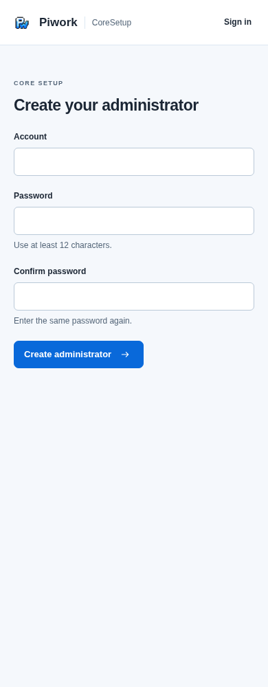
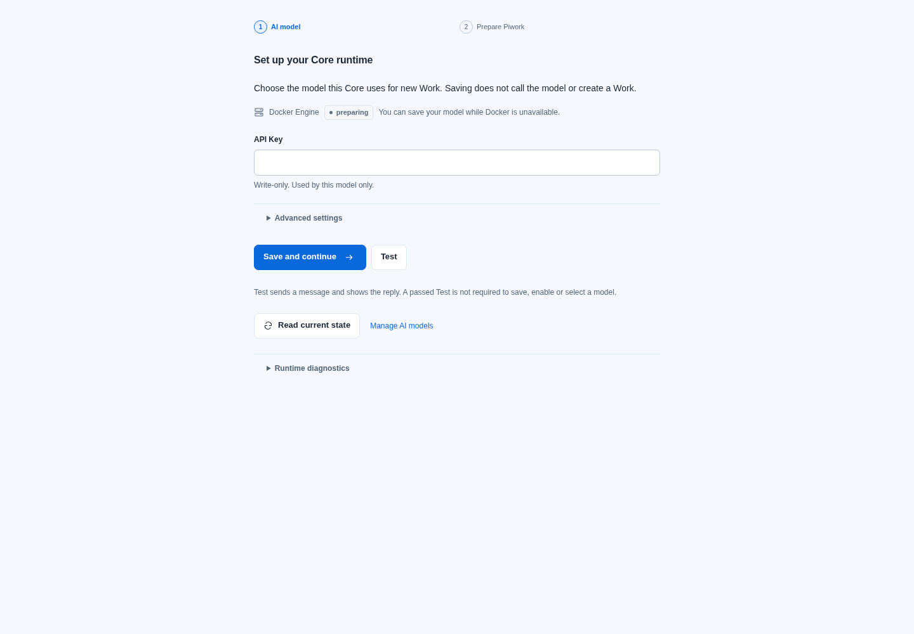
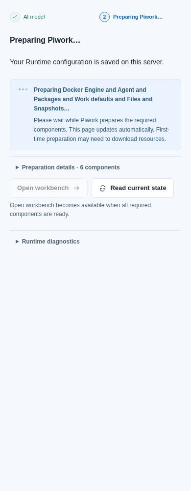
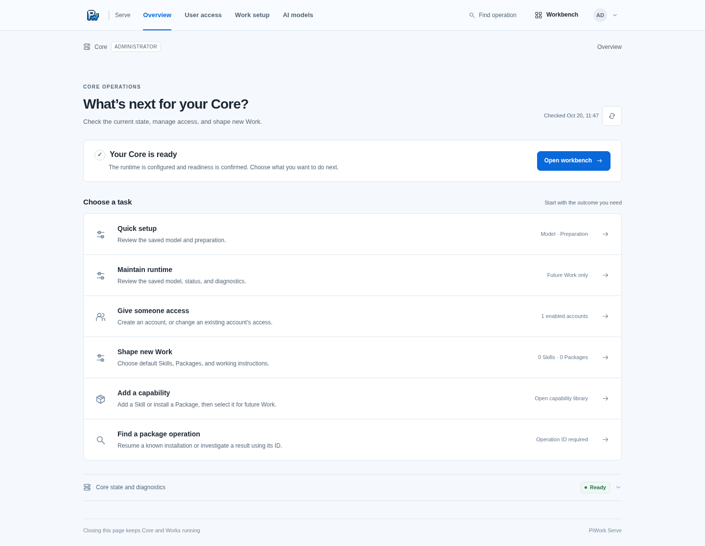
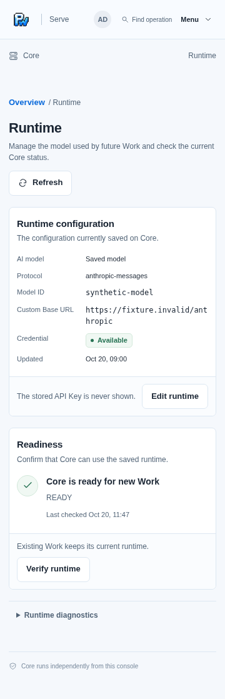
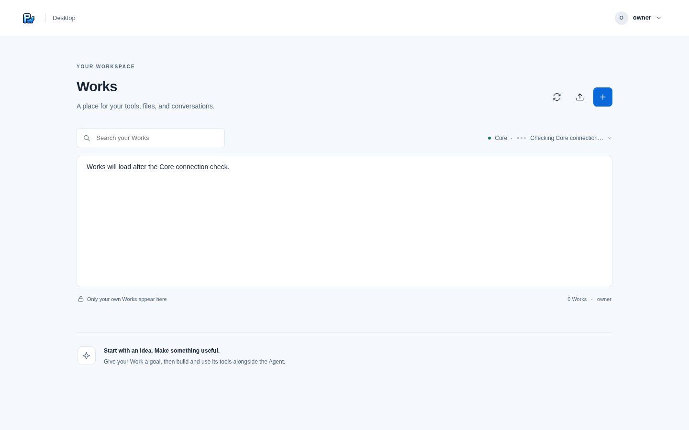
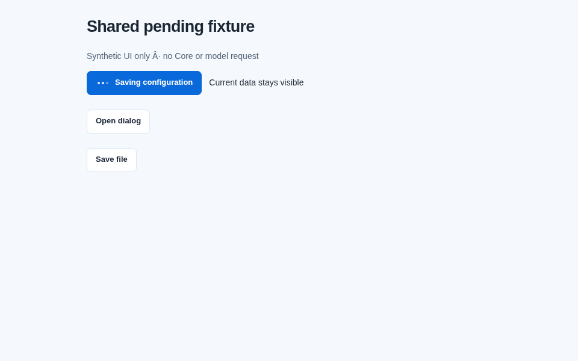

# 实施与验证记录

当前适配基线：v0.0.9 main `a6c36da16ebcc0e96f0e34ef820d857f2bea4877`。本次rebase验证见文末专节；下文v0.0.8、重建与Session结果均属于各自历史提交，不自动算作新基线通过。

## 1. 范围与结果

- 四模块：首设界面、QuickStart、管理体验、共享Pending。具体31位置对应代码和测试见 [pending-map.md](pending-map.md#5-本次实际接入与复用验证)。
- D1：本次用户主动保存首设后，当前配置仍匹配且六项完整Ready，最多自动进入工作台一次；既有Ready、管理、刷新、离开、改稿、unknown不建立或继续导航意图。
- D2原生启动授权link移出本轮；D3仍创建后手动正常登录。没有Go/Core/后端认证或运行逻辑修改。
- 新空模型默认`deepseek-flash`、`anthropic-messages`、`https://api.deepseek.com/anthropic`，仅Key默认显露。自定义配置不覆盖；只用合成值，未调用付费模型。
- 两端资源经原copy-static/sync脚本生成；`internal/*assets/static`仅为对应UI嵌入资源。

## v0.0.8 适配验证（2026-10-20）

实现提交：本地 `148c716e2dcf1a96d4e74e3d3b6339c121423c1a`，已发布同内容的远端 `058a96090f86fca1db956bdb9020a59b5358d28f`，实现 tree `f0afb0db3a32c45813b61b1ffdb88b854b297794`。合并保留原 PR 与 main 两个父提交；相对 main 的所有产品改动仍仅为 UI、对应测试与生成 UI 资源，Core/CLI/后端认证/contracts/scripts/deploy 字节与 main 完全一致。

- 采用 v0.0.8 普通 `state/session`、CSRF 与自动浏览器 Cookie 确认；旧 `#setup` / `#ticket` 只清除，不调用已移除的设置授权或浏览器授权端点。
- 创建管理员后仍清空密码并手动登录；未知创建、并发 409 只读回，不自动重发。补齐 CSRF 恢复、state/session 失败、pagehide/pageshow 后旧创建/登录/退出响应不清除新草稿或解新锁的合成回归。
- 补充一条实际前端导航 `/setup → /login → /admin/setup` 的合成链路：创建、手动成功登录、Key-only 保存、六项分别非 ready 均阻止完成、全部 ready 仅一次导航回调。断言仅四次明确写入，密码/Key 不进入浏览器存储；不是原生 Core 端到端验收。
- Desktop 保留上游 sessionCreated 的 Cookie 读回与中断重试，并沿原身份代次将 Core 检查归属本次接受的会话，旧响应不终止新等待。
- 独立审查确认上述归属与恢复逻辑；发现的旧 Console 授权夹具已改为普通会话，未回滚产品契约。视觉复核另修正初次 Core 检查期间页脚把未知列表显示为 `0 Works`：现在显示 `Works not yet read`，确认空列表后才显示 0，并在同一延迟 Core 浏览器测试断言两阶段。

| 最终不重复计数的检查 | 结果 |
|---|---|
| Console QuickStart / 首设 / 会话及完整合成链路 | 44/44 通过 |
| Console feedback + management | 94/94 通过 |
| Desktop 六个可运行 browser suite | 338/338 通过，0失败/跳过 |
| Desktop 24个非浏览器 unit/渲染契约 | 524/524 通过，0失败/跳过 |
| 两端 typecheck/build、Desktop 测试编译 | 通过 |
| OpenSpec strict、repository-docs、native-boundary、diff空白 | 通过（最终复查） |
| UI嵌入资源逐文件hash | Console browser12/public4、Desktop browser23/public4，全部相等 |

最终 Console 命令与初版相同，但一次执行 `quick-setup.spec.mjs feedback.spec.mjs management-flow.spec.mjs`，总计138。最终 Desktop 浏览器使用相同六个文件，`--test-concurrency=3`；unit仍为下文24文件、`--test-concurrency=2`。本轮日志位于忽略目录 `dist/ui-review/*-upstream*.log`。此前一次 Desktop 338/338 与 Console137/137是中间验证，不与最终结果相加。

发布核对（2026-10-20 04:32 UTC）：GitHub connector发布的实现tree与本地Git tree完全一致，保留父提交 `8b271841` 与 `9a40d444`；`git ls-remote`确认分支已指向 `058a9609`。PR #3仍open、Draft、未合并，GitHub报告mergeable=true。最终规格/截图作为单独文档提交，不改变已测试产品代码；未部署或归档。

最新普通首设页面（390px，真实构建前端+合成API）：

<p align="center"></p>

未测边界保持：没有 Go 编译器或原生 Core/CLI 二进制，`/usr/bin/go` 是同名棋类应用而非 Go 工具链；没有运行原生认证/Core/Engine/Docker集成、Go宿主重建或付费模型请求。本 PR 不以 mock 的138/338结果替代这些未测项。当前仓库没有 `.github/workflows`；远端实现commit的查询返回 `statuses: []`、`workflow_runs: []`，没有CI通过结论或可等待的运行。

## 2. 初版验证命令与结果（8b271841）

执行环境：Node 24.19、npm 11.9、云桌面原生Chromium。exec环境无法建立Chromium单实例socket，浏览器测试在同一云桌面Terminal正常执行，没有关闭安全机制或发布公网fixture。API均由测试夹具提供，使用真实构建的前端页面。

| 检查 | 最终结果 |
|---|---|
| 两端typecheck/build、Desktop测试TypeScript编译 | 通过 |
| Console QuickStart合成浏览器 | 28/28通过 |
| Console既有feedback及新增management-flow | 94/94通过（65+29，不含重复轮次） |
| Desktop全部可运行浏览器suite | 6个文件，335/335通过，0失败/跳过 |
| Desktop全部非原生unit/渲染契约 | 24个文件，525/525通过 |
| OpenSpec strict、文档归属、native-boundary、diff空白 | 通过（最终复查） |
| UI嵌入资源逐文件hash相等 | Console browser12/public4、Desktop browser23/public4，全部相等 |

构建：

```sh
npm run typecheck -w @piwork/console-webui -w @piwork/desktop-webui
npm run build -w @piwork/console-webui -w @piwork/desktop-webui
npx tsc -p apps/desktop-webui/tsconfig.test.json
```

Console的云环境只读测试配置沿用`apps/console-webui/playwright.config.mjs`，仅将`use.channel`置空、`launchOptions.executablePath`设为`/usr/bin/chromium`，testDir保持原目录；临时配置位于被忽略的`dist/ui-review/playwright.config.mjs`。标准安装可直接使用原配置与其已安装Chromium。

```sh
PIWORK_TEST_BROWSER_BIN=/usr/bin/chromium PIWORK_UI_EVIDENCE=1 \
  npx playwright test -c dist/ui-review/playwright.config.mjs quick-setup.spec.mjs --reporter=line
PIWORK_TEST_BROWSER_BIN=/usr/bin/chromium PIWORK_UI_EVIDENCE=1 \
  npx playwright test -c dist/ui-review/playwright.config.mjs feedback.spec.mjs management-flow.spec.mjs --reporter=line
PIWORK_TEST_BROWSER_BIN=/usr/bin/chromium PIWORK_UI_EVIDENCE=1 PIWORK_PENDING_EVIDENCE=1 \
  node --test --test-concurrency=2 \
  apps/desktop-webui/dist/test/{feedback,local-auth,preferences,recovery,final-acceptance,pending-dots}.test.js
```

最终unit命令（24个文件）：

```sh
node --test --test-concurrency=2 \
  apps/desktop-webui/dist/test/action-hierarchy.test.js \
  apps/desktop-webui/dist/test/action-state.test.js \
  apps/desktop-webui/dist/test/chat-markdown.test.js \
  apps/desktop-webui/dist/test/chat-projection.test.js \
  apps/desktop-webui/dist/test/compact-work-controls.test.js \
  apps/desktop-webui/dist/test/completion-exits.test.js \
  apps/desktop-webui/dist/test/continuity-adapter.test.js \
  apps/desktop-webui/dist/test/control-adapter.test.js \
  apps/desktop-webui/dist/test/control-rules.test.js \
  apps/desktop-webui/dist/test/draft-revision.test.js \
  apps/desktop-webui/dist/test/export-adapter.test.js \
  apps/desktop-webui/dist/test/export-admission.test.js \
  apps/desktop-webui/dist/test/export-flow.test.js \
  apps/desktop-webui/dist/test/file-admission.test.js \
  apps/desktop-webui/dist/test/file-results.test.js \
  apps/desktop-webui/dist/test/lifecycle.test.js \
  apps/desktop-webui/dist/test/modal-presentation.test.js \
  apps/desktop-webui/dist/test/navigation-review-regressions.test.js \
  apps/desktop-webui/dist/test/overlay-role.test.js \
  apps/desktop-webui/dist/test/pause-projection.test.js \
  apps/desktop-webui/dist/test/pending-adapter.test.js \
  apps/desktop-webui/dist/test/work-navigation.test.js \
  apps/desktop-webui/dist/test/workspace-hierarchy.test.js \
  apps/desktop-webui/dist/test/workspace-layout.test.js
```

上述浏览器组与unit组不重叠，不以多轮测试计数相加冒充覆盖量。详细临时日志保留于`dist/ui-review/`并包含在恢复包。

## 3. 独立审查与失败修复

真实实现问题均修复后增加针对回归，未用删除断言掩盖：

1. Quick setup首次目录读取失败后恢复重建表单，丢Key/焦点：只对未编辑首次基线重建；编辑过原位更新，断言同DOM、Key、焦点、选区。
2. 管理unknown保存后普通Refresh抹掉只读恢复入口但仍锁住Save：保留原未确认状态、锁及读回入口，覆盖成功/失败刷新。
3. 独立Console自身401递增identityEpoch，被旧响应guard丢弃：先正确处理本会话失效，同时旧请求不得登出新管理员；覆盖Runtime、Default Work、Operation、Model与新身份。
4. Desktop同浏览器session generation更新中断Core检查：本请求接受的新会话继续检查；外部身份/认证变化仍淘汰旧请求。
5. Activity混合失败与运行工具没有动画、或读取失败的旧Run仍动画：按当前有效观测显示唯一主等待，保留错误与恢复，覆盖mixed工具和独立Run证据。
6. 同Dialog body/footer出现重复等待：限定同一Dialog与原action归属，新增两个Dialog隔离回归。
7. 完整模型管理的Test缺10秒说明：复用记录时间、局部刷新和view/identity清理；虚拟时钟验证摘要与打开弹窗，终态不继续动画。

扩大回归首次500例中29失败分类：19项为源码提取测试未注入新纯渲染helper；6项为原skeleton/固定icon结构断言与新局部三点不符；4项为浏览器旧等待文案/位置选择器。夹具改为提取真实helper，保留原锁、焦点、布局、独立对象和晚响应断言；浏览器新增唯一三点、开始/结束与不污染新Modal的断言。修正后已在最终完整6个浏览器suite（335/335）与24个unit文件（525/525）分别验证，未将中间定点重跑加总。

## 4. 明确未验证

- 当前无可用Go编译器或已构建原生Core/CLI。`browser.test.ts`、`native-auth.test.ts`、`onboarding.test.ts`及Console `console.spec.mjs`依赖原生二进制，本轮未运行。
- 未执行真实Core/Docker初始化、镜像拉取、Work容器生命周期、后端认证集成、`make build/test`或生产部署；没有为本次UI扩大环境建设。
- 未配置真实Key或发送真实模型请求。provider路径测试使用既有Messages SDK注入合成fetch，仅验证`/anthropic/v1/messages`和默认序列化。
- 静态壳只在HTTP已监听后存在；没有声称浏览器能在Core监听前显示启动页。
- UI嵌入资源已同步，但无Go宿主重建；PR/CI应在既有具备Go/Docker的环境运行原生集成。此限制不是本地通过记录。

## 5. 图示证据

以下均为本次真实构建UI、合成API；无真实Key/密码/个人数据。截图用于观察布局，状态正确性依赖测试断言。

### S04 · Key-only Quick setup（1440px）

<p align="center"></p>

### S07 · 准备主状态与折叠六项（390px）

<p align="center"></p>

### S08 · 管理入口与返回工作台

<p align="center"></p>

### S09 · 当前Runtime维护（360px）

<p align="center"></p>

### D02 · Core请求等待（非启动器）

<p align="center"></p>

### 共用三点 · 真实Chromium录帧

<p align="center"></p>

共享测试通过真实requestAnimationFrame采样校验1.2秒opacity、固定24×16槽及邻居几何不移动；GIF由同一浏览器截图序列编码，仅作视觉佐证，不是设计生成图。

## 6. Verify总结与交付

- Completeness：8项Requirement/64个Scenario均有实现或明确保留契约，31位置接入完整；任务仅按最终结果勾选。
- Correctness：合成UI和单元边界以最终测试为准；真实Core/认证/Docker集成未验证，原因见上。
- Coherence：复用ActionState和既有代次/对象锁，纯UI渲染helper；不引入新的全局Pending状态框架或导航状态机。
- 本地可运行验收完成；[Draft PR #3](https://github.com/pphboy/piwork/pull/3)已发布，未合并。未自动合并或部署；不自动归档本change。


### 发布核对（2026-10-20 03:09 UTC）

- 普通git push因本地无HTTPS凭据失败，改用已连接GitHub connector发布，没有创建或配置凭据。
- 四个功能/规格提交的每棵远端tree均与本地测试提交相同；最终实现tree为`42b9f370d5874379feafd3b3f05253c27cf6ee75`，发布HEAD为`1d9925db42781060d8e3814a4c7fbc4130f5c648`。connector生成作者/时间元数据，因此commit SHA与本地不同，不是内容差异。
- 远端基线仍为`efce08c228c12f10d18a968b69c3398bb0e783e1`；独立复核PR open、Draft、未合并，63文件范围仅UI/test/generated UI assets/OpenSpec。
- GitHub首次核对返回`statuses: []`及`workflow_runs: []`，当前仓库也没有`.github/workflows`目录。没有CI通过结论或正在运行的CI可监控；真实Go/Core/认证/Engine仍未验证，继续保持Draft。
- 本节与task 4.8的收尾为后续纯文档提交，不改变已测试实现tree中的任何产品或测试文件。没有合并、部署或归档。

## 7. 同日页面收敛与重建验收（2026-10-20）

### 来源与范围

此前未发布工作区（最后记录为0fba29e）及其本地bundle已不可取得。本次重新克隆并核实 PR 基线 `3fe9f14975850de1015eaaa65ccc3acd72e123f9`，main仍为 `9a40d4443fee559335485744d0aabbf186e24b38`。这是按原需求和新反馈重新实现，不是原未发布提交的逐字恢复，不能引用旧测试数字证明新代码。

当前功能提交：`d0206b7`（Quick setup安全回读）、`5943020`（菜单连续性）、`db70b3e`（Works加载/错误）、`d552ccb`（导出明细）。与main相比不含Go/Core、后端认证/运行、contracts、scripts或deploy修改；仅UI源码、前端测试、已有生成UI资源及本change。

- Quick setup模型页移除常驻 Read current state、Manage AI models 和 Runtime diagnostics，准备页/完整管理原入口保持。未知结果及目录失败由原五秒更新走完整只读核对；正常读取仍轻量。仅未解决unknown警告有 Review saved models，不在普通错误/目录错误/正常页面重加入口。Test与写入保持锁，不重发修改，不恢复自动导航。
- Works首次未确认采用立即可见的静态骨架，保留Core局部等待。首次失败只留中间原因和Retry loading；已确认行/确认空集合刷新失败仍有反馈。初始Core检查失败而从未读取Works时显示Works have not been read，不冒充空列表或搜索无结果。
- 同页状态读取保留Console账户/窄屏导航展开、DOM、焦点和ARIA；新视图或身份仍关闭。Overview未完成项不写成已完成。
- Starting export明细的操作链接曾被通用复制图标样式限制为27×27px；仅导出明细恢复全宽、自适应高度，长ID可换行且行高增长，Snapshot/原链接与状态完整保留。补状态与说明间的空格。Details默认折叠、Pause/Hide、下载及原Operation语义不变。

### 复核发现及对应回归

1. 新模型unknown恢复后不可借用另一个旧Runtime直接进入准备，多个匹配仍要求明确选择；VM契约和浏览器覆盖。
2. 读取失败不得覆盖保存拒绝，随后健康读取只清除自己的错误；单独读错误槽及连续失败/恢复回归。
3. SVG被DOM规范化会使字符串比较失效，重复相同失败导致恢复链接重建丢焦点；按节点身份与生成markup缓存，真实浏览器和序列化契约验证。
4. 重复unknown警告、未知状态下可触发Test、菜单ARIA重置、初始Works未确认误显搜索空态均有对应断言，不调整Core状态机。
5. 导出长UUID及192字符token在1440/360px逐行核对文字/按钮边界、不重叠、不横向溢出。滚动后Check status和Pause完整处于正文可视区、位于footer之上、中心点命中原按钮，聚焦后仍无遮挡；截图回到顶部，不代表下方控件不可到达。

### 当前重新执行的验证

- Console最终不重叠浏览器覆盖：feedback/management 97项（完整150项运行中的该分组）+最后Quick setup/onboarding/session 54项，共151项；全部通过，无失败/跳过。追加初始读失败保留原因的回归后，Quick组已单独完整重跑，不把150和54相加。
- Console生产函数恢复契约38/38通过；Desktop24个非浏览器文件531/531通过。
- 导出呈现专用文件2/2通过（1个生产渲染契约、1个浏览器宽/窄布局与可达性场景），包含最终文字分隔及滚动命中断言。
- Desktop原有六个可运行浏览器suite最终完整运行341/341通过，0失败、取消或跳过；于2026-10-20 11:04:12 UTC完成，包含最终导出样式/文字。
- 两端typecheck/build、Desktop测试编译、43个嵌入资源逐文件manifest/hash、native-boundary、repository-docs、OpenSpec strict、git diff --check通过。所有当前可运行组已完成，不把开发过程的重复运行累加为覆盖量。

实际命令沿既有入口：`npm run typecheck -w @piwork/console-webui -w @piwork/desktop-webui`，`npm run build -w @piwork/console-webui -w @piwork/desktop-webui`，`npx tsc -p apps/desktop-webui/tsconfig.test.json`；Console运行quick-setup/feedback/management-flow三文件，Desktop运行feedback/local-auth/preferences/recovery/final-acceptance/pending-dots六文件和新增export-presentation。浏览器指定系统Chromium；直接执行器启动遇到socket限制，使用正常云端Terminal运行，未绕过被拒绝的文件或发布操作。开发中被新导出修复替代的中间运行被停止，不算通过或累计覆盖。

### 明确未测与发布边界

当前没有可用Go编译器（PATH中的`go`并非Go语言工具链）、原生二进制或Docker。依赖它们的Desktop browser/native-auth/onboarding与Console console.spec、真实Core/后端认证/Docker/付费模型和Go宿主重建仍未运行；未建立额外集成环境。所有截图是实际构建UI与合成API/生产渲染fixture，不是真实Core任务、真实密码/Key或付费请求。

GitHub只读核对确认[PR #3](https://github.com/pphboy/piwork/pull/3)仍open/Draft、未合并，HEAD仍为3fe9f149。发布暂停，本轮没有GitHub写入、推送、合并、部署或OpenSpec归档。本地提交与最终可恢复bundle另行交付。


### 本轮最终图示

均于本轮重新构建后在真实Chromium生成，使用合成API或真实生产渲染函数fixture；不是原生Core集成结果。宽屏为1440px，Quick setup窄屏390px，Works/Export窄屏360px。

- Quick setup移除三个常驻底部入口：[宽屏](evidence/review-20261020/quick-setup-wide.png)、[窄屏](evidence/review-20261020/quick-setup-narrow.png)。异常unknown恢复链接未出现在正常页中。
- Works首次检查骨架：[宽屏](evidence/review-20261020/works-skeleton-wide.png)、[窄屏](evidence/review-20261020/works-skeleton-narrow.png)。
- Works首次失败只留中间错误/重试：[宽屏](evidence/review-20261020/works-error-wide.png)、[窄屏](evidence/review-20261020/works-error-narrow.png)。截图等待原有临时toast自然结束，未隐藏页面元素。
- Starting export展开明细：[宽屏](evidence/review-20261020/export-starting-wide.png)、[窄屏](evidence/review-20261020/export-starting-narrow.png)。底部控件位于可滚动正文内，可达性由实际滚动/命中/焦点断言确认。
- Preparing export展开明细：[宽屏](evidence/review-20261020/export-preparing-wide.png)、[窄屏](evidence/review-20261020/export-preparing-narrow.png)。
- 同页后台读取保留菜单：[账户菜单](evidence/review-20261020/account-menu-wide.png)、[窄屏导航](evidence/review-20261020/navigation-menu-narrow.png)。

### 本轮Verify结论与恢复交付

- Completeness：当前8项Requirement / 72个Scenario，新增页面收敛与导出场景均有实现和定向回归；历史契约保留，不把原生未测记作通过。
- Correctness：最终Console浏览器151项、恢复契约38项；Desktop六组浏览器341项、24个unit文件531项、导出专用2项，均通过。导出2项中的1项是浏览器、1项是生产渲染契约，各分组无重复计数。
- Coherence：保留原页面代次、对象锁和读回模式，没有新增全局状态框架或Core行为。独立只读终审未发现阻塞问题或越界修改。
- 本地功能分四个提交，文档和本轮截图另行提交；完整Git bundle包含当前分支历史、源码、测试、生成资源及OpenSpec证据，可独立恢复。临时测试日志不在Git bundle内，另随验证记录压缩附件提供，避免将工作目录日志误说成Git内容。
- 恢复附件仅交回用户保存，不能视为GitHub已更新。线上PR仍为3fe9f149，发布权限问题仍待确认；不合并、部署或归档。本地bundle校验值与恢复命令在随附manifest中给出。

## 2026-10-20 Session 选择器专项验收

### 来源与范围

本轮从已持久保存并精确恢复的 `7f7221e5e8a39cb713b2db928e8dd7c871e76272` 出发，只实现用户22:35 UTC截图要求的Session选择器收敛。此前丢失的 `ef676b6` 全面审查修改未被恢复，也不能当成本轮基线。先读取本轮实际PNG，再在同一change更新proposal/design/spec/tasks，随后apply、测试和独立Review。实现提交 `a1bb406659f7b4c9f5e4b7f47b5b8f87d6626aab`。

生产修改仅在Desktop `src/app.ts`、`public/style.css`及对应嵌入资源：
- New session保留规范要求的顶部位置，改为独立的次级按钮，与列表分隔12px；短行最低48px，长名称完整换行，图标与状态不挤占名称。
- 轻量选中底色和独立勾选标记，Run徽标放在名称之下。保留切换不停止Run的事实说明，移除重复footer Close，头部命名关闭仍在。
- 打开时明确优先当前选中项，并允许把长列表底部选中项滚入可见区域。两个既有Session入口有独立稳定ID，修正原来混用data-action导致的错误锚定和返回焦点；原入口暂被读取锁禁用时仍采用原安全回退。
- 不改adapter、Session选择/创建处理器、Run处理器、Core/backend或其他浮层。与主线 `9a40d4443fee559335485744d0aabbf186e24b38` 对比，Go文件、apps/agentd及packages没有变化。新增改动只在Desktop UI、测试、生成资源及本change。

### 测试与视觉证据

使用云桌面系统Chromium、真实编译前端及合成API。没有真实模型Key、用户Session数据、付费调用、Docker Work或真实Core运行。截图不是设计生成图，也不证明真实后端集成。

- Desktop24个非浏览器文件：533/533通过，0失败/取消/跳过；新增两项渲染回归覆盖选中+运行标记、名称转义，以及加载/空/错误/保留列表刷新区分。
- Session专项4/4浏览器回归通过：1440/360px与480px短视口、长token、当前选中末项复开、两个入口焦点、Home/End/Arrow/Enter/Escape、无意外POST、草稿保留、单次创建及局部等待、读取锁焦点安全回退、失败刷新保留列表与Retry恢复确认空态。前三项曾连续执行三轮均通过，不累加为覆盖数量。
- 最终完整可运行组合347/347通过，0失败/取消/跳过，退出码0，用时302.388秒。其中原六组浏览器加新增Session回归345项，导出呈现补充2项（1项浏览器、1项生产渲染契约）；均与上述533项分组不重叠。终态于2026-10-20 22:57:58 UTC确认。
- Desktop typecheck/build、测试编译、43个两端已构建资源manifest与逐文件SHA256对齐、native-boundary、repository-docs、git diff --check通过。Console源码未改，本专项不把此前Console测试重新声称为本次执行。

命令与临时日志在忽略目录 `dist/session-style-2237/`：`unit-full.log`、`after-browser.log`、`final-browser.log`、`final-static.log`及`assets-manifest.json`。最终完整可运行组为：

```sh
PIWORK_TEST_BROWSER_BIN=/usr/bin/chromium node --test --test-concurrency=3 \
  apps/desktop-webui/dist/test/{feedback,local-auth,preferences,recovery,final-acceptance,pending-dots,export-presentation}.test.js
```

before图片通过拦截静态资源加载同基线的app.js/CSS，after使用当前正常构建；其余fixture相同。1440px、360px各保留短列表和长名称图，after另有480px高视口末项键盘焦点图。名称为`sessions-{before,after}-{1440,360}.png`、`sessions-{before,after}-long-{1440,360}.png`、`sessions-after-short-{1440,360}.png`，包含在本轮恢复附件中。原图只用于理解需求，不作为合成截图交付。

开发中发现并处理：原混合querySelector实际先聚焦Close；两个同data-action入口错误定位；选中末项preventScroll导致不可见；局部CSS优先级被旧通用span规则覆盖。独立Review已核对最终源码、测试、生成资源及宽/窄/短视口像素，无剩余阻塞。两项早期测试误把读取锁期间禁用的原触发器当作可聚焦对象，调整为“可用时精确恢复”和独立“锁定时安全回退”断言，不修改原锁或删除恢复验证。

### OpenSpec verify与交付限制

- Completeness：本专项任务6.1–6.4完成，change任务28/28；change共8项Requirement、74项Scenario。本轮新增的DWUI-011两项Session场景分别由上述渲染/几何及交互/恢复测试映射；历史其他场景记录仍保留，不能解释为丢失审查已重建。
- Correctness：上述实际执行范围内无已知功能阻塞；真实宿主/Core/认证/Docker集成未验证，当前没有dist/go/piwork-cli或piwork-serve及可用原生集成条件，故未运行依赖这些二进制的browser/onboarding/native-auth套件，也未建设新后端环境。
- Coherence：使用现有popover/listbox、按钮、badge及focusKey模式，New session仍位于顶部；无新框架、业务状态或会话请求语义变更。OpenSpec strict通过，不执行archive、merge或deploy。
- 交付状态：本地提交、补丁和增量bundle已用持久基线的独立clone验证相同tree；实现补丁的独立记录已回读核验，但这不是用户可下载附件；Library必需上传helper仍在tools/list阶段HTTP403，之前同一路径明确未上传且重试失败，本轮没有再次尝试或换路线。GitHub写入仍暂停，本轮未推送PR。不能把本地图片/恢复包称为已送达用户的附件。

## v0.0.9 main rebase验收（2026-10-21）

所有者要求rebase主分支。远端实际主分支是main，不存在master；确认并fetch的目标为`a6c36da16ebcc0e96f0e34ef820d857f2bea4877`。重放前的完整保留分支为`6b099bf2b0dfdfde6a38113d734ec8ab87089858`，工作树干净，已建立备份分支及验证完整bundle。使用`git rebase --rebase-merges --onto a6c36da1 9a40d444`保留功能提交边界和已有合并结构；原v0.0.8协调提交的UI解决结果完整保留，再组合新main的UI差异，后续setup/Works/export/Session提交顺序重放。不是丢失ef676b6审查的恢复。

### 冲突决策与边界

- 冲突位于onboarding、Desktop adapter/app、action-hierarchy测试及对应嵌入资源；没有Core冲突解决或后端改写。相对保存的6b099bf，产品源码仅增加上游的三份UI文件差异。
- Service检查完成保留`origin + (basePath ?? '/')`，沿上游完整Service目标继续预览/独立打开；保留上游iframe身份/输入不因布局变化丢失的浏览器回归。
- 登录成功和已登录/login均通过上游nextLocation处理同源Service returnTo；不改上游URL校验。托管身份清理与成功注销清除piwork:web:缓存，Console合并时将原current(ticket)保护放在整个清理及跳转之前，旧注销成功不能清掉新视图存储或释放新请求锁。
- 保留上游Service同源可信应用、前缀支持及Cookie限制说明。Quick setup底部入口收敛、自动只读unknown恢复、Works骨架/单一初错、export明细和Session选中/焦点/长名称修正均保留。
- `a6c36da1`为最终分支祖先；相对它只有两端WebUI、shared controls、生成UI资源和本change差异。Core/Go、Agent、contracts、部署/发行、脚本与主规格完全等于上游，不将上游自身的架构变更计为本PR修改。

### 最终实际检查

| 不重叠检查组 | 结果 |
|---|---|
| Desktop24个非浏览器文件 | 536/536，0失败/取消/跳过 |
| Console Quick setup恢复单元 | 38/38，0失败/取消/跳过 |
| Desktop原六组浏览器及export呈现补充 | 348/348，0失败/取消/跳过；含1项上游新增Service前缀浏览器回归，export补充中1项是生产渲染契约 |
| Console既有三个可运行浏览器文件 | 151/151通过 |
| Console新增controlplane-compat浏览器回归 | 15/15通过；标准test:browser已纳入此文件 |
| 两端typecheck/build、Desktop测试编译 | 通过 |
| 43个UI构建/嵌入资源SHA-256对应 | 全部相同，独立Review重复确认 |
| native-boundary、repository-docs、diff检查、OpenSpec strict | 通过 |

新增Console15项实际加载编译后的onboarding：验证正常登录/已登录两条返回路径的query/hash；拒绝外部、协议相对、非Service、两种点路径归一化逃出Service的目标并保留服务端fallback；注销成功只清指定sessionStorage前缀、不清相似键/其他键/localStorage；失败保留；pagehide/pageshow后旧成功不能清新缓存、跳转或解除新注销锁。Desktop新增3项验证hosted/local身份清理边界和存储读取异常下原清理仍完成。独立Review未发现产品阻断；指出新测试未接入常规脚本，已修正并核对。

首次直接exec启动浏览器未能完成套件初始化，已中止且不计为产品断言失败；最终两端浏览器均经云电脑Terminal启动标准系统Chromium完成。新增存储异常测试最初误要求clearIdentity修改signedIn，调整为其现有清空对象列表契约后536项全部重跑通过，未因此修改产品行为。所有界面/网络响应均为合成fixture，无真实账号、Key或付费模型请求。

实际命令与终态日志位于忽略目录`dist/rebase-v009-0016/`：`run-desktop.sh`（348）、`run-console.sh`（151）、`run-compat.sh`（15），对应exit文件均为0；`desktop-unit.log`与`console-unit.log`分别536和38。两端标准build/typecheck、`tsc -p apps/desktop-webui/tsconfig.test.json`、原24文件清单node --test、Quick setup恢复node --test已重跑。临时Console配置只沿原配置使用系统Chromium和隔离结果目录，不修改产品或测试断言。

本次新Session宽1440/窄360、长名称和短视口截图在`/workspace/shared/piwork-rebase-screenshots/`，实际像素复核与浏览器几何/焦点断言通过，不能当作真实Core证据。用户先前截图展示的样式没有被rebase回退。

### 未测与交付

真实原生host/认证/Core/Docker整合和Go宿主重建未运行：工作区没有`dist/go/piwork-cli`或`piwork-serve`，亦无已配置隔离运行环境。Desktop `browser/native-auth/onboarding`、Console `console.spec`和real-core套件因此未运行，不能将合成浏览器通过当作整合通过。未合并、部署或归档。

本次只做本地rebase及验证；GitHub写入仍暂停，远端PR #3没有被更新，不声称其远端冲突已解除。Library先前附件上传403本次没有盲重试。最终本地恢复包、精确UI增量与源树校验记录另行保存；恢复可从已保留6b099bf加公开固定a6c36da1主线和本次UI增量逐字复原，内部保存不等于已向用户发送附件。


## 再次同步 main 验收（2026-10-21，目标457650bc）

所有者再次要求“再rebase main”后重新fetch，发现主线从a6c36da1前进7个提交到固定目标`457650bcec742ded30fc61b368d40b02aed0c63f`。先前已验证的2e99278保存为本地检查点和可恢复bundle；本轮使用rebase --rebase-merges继续重放，最终基线以457650bc为准，不把上一轮a6c36da1称为最新完成状态，也不无限追逐后续新提交。

### 第二次冲突处理与独立审查

冲突集中在Console壳的长模板行、初始HTML和生成资源。采用上游Piwork Core静态/动态标题、Core品牌副标题与页脚，同时保留本分支初始loading和同页节点/菜单状态协调；未重新设计页面。保留上游HTTP托管测试入口、fixture程序名变更，以及Playwright全局配置删除ignoreHTTPSErrors。上游console.spec已有单一context同名选项仍逐字保留，本轮不声称全仓库不存在该选项。

独立审查逐blob核对：1,765个非UI路径与新main模式/内容完全一致；最新main为祖先，源差异79个路径全部属于两端WebUI、shared controls、生成UI资源和本change。Desktop产品源码、public、shared和嵌入资源与已通过完整348项的2e99278逐字相同。Console产品相对2e99278仅上游品牌/标题/页脚文本变化；Service完整前缀、returnTo验证、身份清理的晚响应保护和既有页面修正均保留，没有Core/API/CLI/容器/VM实现修改。

### 实际终验与证据边界

再次执行两端typecheck/build、Desktop测试编译，Desktop24个非浏览器文件536/536、Console恢复单元38/38通过；43个构建/嵌入资源SHA256全部一致，native-boundary、repository-docs与diff检查通过。Console四个可运行浏览器文件166/166通过（1.8分钟、退出0），包括上一轮新增15项兼容场景。临时命令和终态日志在`dist/rebase-main-0033/`。

Desktop完整348项采用本次稍早刚执行且产品/fixture依赖相同字节的结果，不虚称第二次全部重跑；上游仅改About夹具中的程序名，该反馈套件另行重跑130/130通过，0失败/取消/跳过，退出0，用时186.727秒；不把这130项再次累加到348项覆盖数。Session截图同样属于第一次rebase后真实云Chromium渲染的相同Desktop字节，不把它们说成第二次重新截图。所有网络均为合成fixture，不代表真实Core运行。

主线上游已删除独立Console并改为Linux piwork-core内嵌HTTP管理，本轮完整继承这些非UI变化。真实host/Core/认证/Docker集成及Go宿主重建仍未运行：工作区没有dist/go/piwork-core或piwork-cli，可见/usr/bin/go不是可用Go编译器；Console console.spec现在需编译hosted-ui-fixture，Desktop原生依赖及real-core套件仍不具备条件。不建设新后端环境，不将这些未测项标为通过。

第二次结果仍仅本地：没有push、merge、deploy或OpenSpec archive；先前GitHub写入暂停和Library helper HTTP403未被绕过。恢复包将基于固定457650bc，上游非UI diff可从9a40d444机械生成，UI/OpenSpec精确增量从已保留6b099bf应用；两条恢复路线均核对最终tree，内部保留不等于用户附件送达。

OpenSpec verify：本次8.1–8.3完成，整体34/34任务；8项Requirement与74项Scenario的既有实现/映射保持。本次不新增能力规格，检查完整性、受影响正确性和既有模式一致性均无阻塞，真实原生集成列为未验证而非通过。最终仅补充本次验收记录的文档提交，不更改已测试产品字节。
